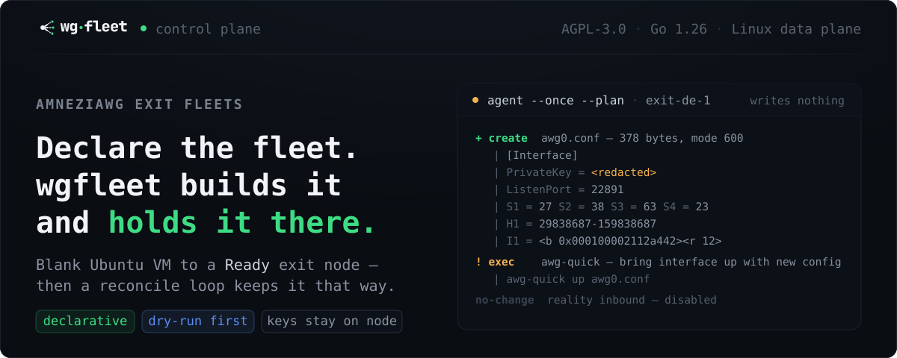
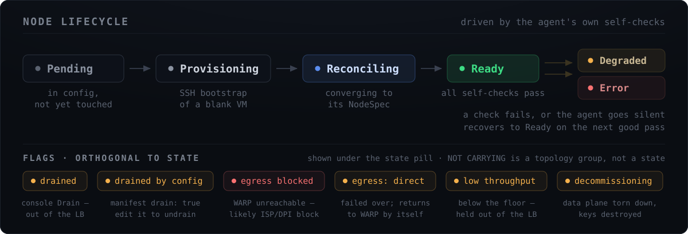

<p align="center">
  
</p>

<p align="center">
  <a href="LICENSE"></a>
  <a href="https://go.dev/"></a>
  
  
</p>

<p align="center">
  <a href="docs/QUICKSTART.md">Quickstart</a> ·
  <a href="docs/manifest.md">Manifest</a> ·
  <a href="docs/operations.md">Operations</a> ·
  <a href="docs/cli.md">CLI</a> ·
  <a href="DISCLAIMER.md">Disclaimer</a> ·
  <a href="SECURITY.md">Security</a> ·
  <a href="CONTRIBUTING.md">Contributing</a>
</p>

---

# A control plane for AmneziaWG exit fleets

You declare the fleet in one config file. wgfleet takes a blank Ubuntu VM,
provisions it into a working exit node — AmneziaWG server, Cloudflare WARP
egress, DNS filtering, policy routing, firewall, metrics — joins it to the load
balancer, and then holds every node at that state with a pull-based reconcile
loop. Think kubelet or Cluster API, but for censorship-circumvention VPN nodes.

It automates a real, hand-built topology: an in-country gateway, several foreign
exits, AmneziaWG obfuscation on every internal tunnel, mihomo load-balancing,
blocky DNS filtering, and a ZeroTier management overlay. The operational lessons
from running that by hand live in the reconcile logic, not in a wiki.

> [!WARNING]
> wgfleet is research / infrastructure-automation software for **lawful** use
> only, provided **without warranty**. It operates VPN and traffic-obfuscation
> infrastructure; the legality of deploying, operating, or using such tools
> varies by jurisdiction and is **your responsibility**. Read
> [DISCLAIMER.md](DISCLAIMER.md) before using it.

| Without wgfleet | With wgfleet |
|---|---|
| SSH into each VM, run Ansible or manual steps | Declare the node in the fleet manifest |
| Copy AmneziaWG keys around by hand | Keys generated on-node; the controller brokers public keys only |
| Hand-edit AmneziaWG obfuscation in a UI | Parameters derived deterministically, then rendered and applied |
| Tweak mihomo / nftables / routing per node | Rendered from desired state, idempotently |
| Hope nothing drifted | A reconcile loop converges and reports health |
| No fleet-wide view | Web dashboard + Prometheus metrics |

---

## See the change before it happens

Autoprovisioning only earns trust if you can read the diff first. Every reconcile
runs as a side-effect-free **plan**: it renders every config, prints the exact
change set with secrets redacted, and writes nothing. One engine enforces this
for all components, so there is no code path that plans one thing and applies
another.

This is real output from the [two-minute local run](#try-it-locally) below — no
root, no VPN tools, no servers:

```console
$ wgfleet-agent --config exit-agent.yaml --once --plan \
    --public-ip 198.51.100.7 --mgmt-addr 10.20.0.5 --state-dir state/exit-de-1

reconcile plan — 36 change(s)

=== firewall (nftables) ===
  + create    state/exit-de-1/wgfleet.nft — 1730 bytes, mode 644
      | #!/usr/sbin/nft -f
      …

=== amneziawg interface ===
  + create    state/exit-de-1/awg0.conf — 567 bytes, mode 600
      | [Interface]
      | PrivateKey = <redacted>
      | Address = 10.81.0.1/24
      | ListenPort = 22891
      | MTU = 1360
      | Jc = 5
      | Jmin = 31
      | Jmax = 91
      | S1 = 27
      | S2 = 38
      | S3 = 63
      | S4 = 23
      | H1 = 29838687-159838687
      | H2 = 717803267-847803267
      | I1 = <b 0xc10000000104><r 4><b 0x0a><r 10><b 0x00><r 101>
      …
  ! exec      awg-quick — bring interface up with new config
      | awg-quick up state/exit-de-1/awg0.conf

=== policy routing ===
  + create    state/exit-de-1/routing.applied — 742 bytes, mode 644
      | ip rule add to 203.0.113.1 lookup main pref 100
      | ip rule add to 10.0.0.0/8 lookup main pref 110
      …

=== exit forwarding (ip_forward + DOCKER-USER) ===
    no-change DOCKER-USER — pending: DOCKER-USER chain not present yet
```

`+ create` · `~ update` · `! exec` · `no-change` — the same four markers for
files, commands and database writes. Drop `--plan` to apply exactly that.

---

## Architecture


Two binaries. **`wgfleet-controller`** holds desired state, brokers keys,
provisions nodes and serves the API, UI and metrics. **`wgfleet-agent`** runs on
every managed node; its role (`master` or `exit`) comes from config. It pulls its
`NodeSpec`, drives the node to it idempotently, and reports health.

All fleet-internal tunnels are **AmneziaWG**, both client↔master and
master↔exit. The only vanilla-WireGuard leg is the external WARP tunnel to
Cloudflare, which does not speak AmneziaWG. Each exit can additionally run a
VLESS + REALITY + XHTTP transport as a **fallback for when AmneziaWG is blocked**
by DPI — switched per-exit from the Web UI, with AmneziaWG staying the default
everywhere else.

---

## What you get

- **Declarative fleet** — describe masters and exits once; the reconcile loop
  converges every node and keeps it there.
- **Autoprovisioning** — a blank Ubuntu VM (SSH only) becomes a `Ready` exit
  node and joins the load balancer, from the CLI or a button in the Web UI.
- **Key broker, not key store** — AmneziaWG keys are generated on-node and never
  leave it. A compromised controller cannot leak node private keys.
- **Dry-run everywhere** — plan mode for reconcile, provisioning, upgrades and
  restore.
- **Support bundle** — one command produces a plain-text archive of diagnostic
  state for someone who cannot reach your servers. It carries no secrets, is not
  encrypted, and refuses to be written at all if a secret survives into it.
- **AmneziaWG obfuscation, done right** — collision-safe S1–S4, per-end decoy
  traffic, real-protocol mimicry, computed MTU. Encoded in the renderer rather
  than left to guesswork ([details](#amneziawg-done-right)).
- **Censorship-adaptive egress** — block detection with automatic WARP ↔ direct
  failover and a throughput watchdog that demotes a throttled path.
- **DPI-resistant client transport** — clients can connect over VLESS + REALITY
  + XHTTP alongside client AmneziaWG; credentials, QR, subscription and a
  ready-to-import Clash config are issued from the Web UI.
- **Two-tier DNS filtering** — blocky on the master and on every exit, with
  conditional forwarding for local zones.
- **Scanner-resistant firewall** — rendered nftables with an auto-refreshed
  scanner-ASN blacklist and a management-overlay allowlist.
- **Observability** — Prometheus `/metrics` on every binary plus a built-in
  dashboard with fleet topology and per-node health.
- **Safe lifecycle** — graceful drain, decommission and teardown, versioned
  upgrades behind a wire-contract gate, and encrypted backup/restore.

---

## Try it locally

Runs the whole control plane on your laptop and shows what a node reconcile
*would* do. No root, no VPN tools, nothing to clean up but a directory. Requires
**Go 1.26+**.

```sh
go build -o bin/wgfleet-controller ./cmd/wgfleet-controller
go build -o bin/wgfleet-agent      ./cmd/wgfleet-agent

cat > controller.yaml <<'YAML'
controller:
  listen:  "127.0.0.1:8443"
  webui:   "127.0.0.1:9000"
  metrics: "127.0.0.1:9300"
  store:   "state/state.db"
  pki:
    ca_cert: "state/ca.crt"
    ca_key:  "file://state/ca.key"
fleet:
  masters:
    - name: master-xa-1
      mgmt_addr: 10.20.25.254
      client_awg: { listen_port: 443, address_pool: 10.80.0.0/24 }
      routing:    { direct_cidrs: [10.0.0.0/8], direct_geo: [RU], balance: health }
  exits:
    - name: exit-de-1
      region: de
      egress: warp
      address_pool: 10.81.0.0/24
      mgmt_addr: 10.20.0.5
      dns_filter: true
      firewall: { as_blacklist: true }
YAML

# Bootstrap the CA and issue each node an mTLS bundle.
bin/wgfleet-controller --config controller.yaml --init-pki
bin/wgfleet-controller --config controller.yaml --issue-node master-xa-1 --issue-out pki/master
bin/wgfleet-controller --config controller.yaml --issue-node exit-de-1   --issue-out pki/exit

# Serve gRPC + Web UI + metrics.
bin/wgfleet-controller --config controller.yaml &

cat > exit-agent.yaml <<'YAML'
agent:
  role: exit
  controller: "127.0.0.1:8443"
  node_id: "exit-de-1"
  identity: { cert: "pki/exit/node.crt", key: "pki/exit/node.key", ca: "pki/exit/ca.crt" }
YAML

# Register + publish this node's public key so the master can peer it.
bin/wgfleet-agent --config exit-agent.yaml --once \
  --public-ip 198.51.100.7 --mgmt-addr 10.20.0.5 --state-dir state/exit-de-1

# Plan it: renders awg0.conf, nftables, routing, wgcf and blocky — writes nothing.
bin/wgfleet-agent --config exit-agent.yaml --once --plan \
  --public-ip 198.51.100.7 --mgmt-addr 10.20.0.5 --state-dir state/exit-de-1

open http://127.0.0.1:9000                       # dashboard
curl -s http://127.0.0.1:9300/metrics | grep wgfleet_
```

Rendering, dry-run, PKI, transport, store, metrics and UI all run cross-platform.
Applying is Linux-only — on macOS an apply stops at the first missing tool
(`nft`, `awg-quick`, `ip`, `wgcf`, `docker`) and reports `Error`, which is why
the run above stays in plan mode.

---

## Deploy a real fleet

**Start with [`docs/QUICKSTART.md`](docs/QUICKSTART.md)** — two blank Ubuntu
servers to a working VPN in about 30 minutes, no prior knowledge assumed.

Each release ships one version-stamped archive per architecture containing both
binaries, the installer, `INSTALL.md`, reference configs and systemd units.
Unpack it on the master and run the installer; it installs the host dependencies
(AmneziaWG kernel module, ZeroTier, Docker), the binaries, the units and config
templates, then prints the remaining operator steps.

```sh
tar xzf wgfleet-<version>-linux-amd64.tar.gz && cd wgfleet-linux-amd64
sudo ./install.sh
# or seed values up front:
sudo ZT_NETWORK=<id> PUBLIC_IP=<ip> ./install.sh
```

The installer is idempotent and **starts nothing** — the master needs a
filled-in config and a locally-issued mTLS identity first, and it prints those
exact steps. The annotated manual equivalent is
[`docs/colocated-controller-master.md`](docs/colocated-controller-master.md).

Adding an exit is one manifest entry plus one command (or the **Provision**
button in the UI):

```sh
# Dry-run: collect facts over SSH, show the bootstrap plan, change nothing.
wgfleet-controller --config controller.yaml --provision exit-de-1 --plan

# Apply: harden sshd, lay a baseline firewall, install deps, join ZeroTier,
# install the mTLS identity + agent binary + systemd unit, and start it.
wgfleet-controller --config controller.yaml --provision exit-de-1 \
  --agent-bin /usr/local/bin/wgfleet-agent
```

Bootstrap order is security-first: hardening and a drop-all-but-SSH/ZT/WG
baseline firewall land **before** the node accepts traffic; the agent's own
reconcile later replaces the baseline with the full per-role ruleset.

Each VM needs the environmental bits the provisioner deliberately refuses to do
itself — the AmneziaWG kernel module and the ZeroTier join. One script per VM
handles both:

```sh
ssh root@<vm-ip> 'bash prepare-node.sh <zerotier-network-id>'
```

The provisioner pre-flights the module and aborts if it is absent; it does not
build DKMS for you. Full walkthrough: [`docs/onboarding.md`](docs/onboarding.md).

---

## How it works



- **Declarative desired state + reconcile.** You describe the fleet; agents
  converge each node toward its rendered `NodeSpec` and keep it there.
- **Dry-run is first-class.** `Plan()` is side-effect-free by construction;
  effects run only in apply mode.
- **The controller brokers public keys, never private ones.** AmneziaWG keys are
  generated and kept on each node; only the public key is published.
- **mTLS identity.** Each node gets a client certificate at bootstrap whose CN
  is its node ID. Removing a node from the inventory, or decommissioning it, makes
  the controller refuse to renew that certificate — see the gaps note below for what
  that does and does not buy you.
- **Self-checks drive lifecycle state.** After each apply the agent runs
  role-specific checks — handshake freshness, egress reachability, WARP egress,
  DNS filter, mihomo API — and the derived state feeds the dashboard and metrics.
  If an agent goes silent, a staleness sweep demotes its node to `Degraded`.
- **Customization without forking renderers.** Operators inject deep-merged
  `overrides` and extra files instead of patching the templates.

---

## AmneziaWG, done right

Obfuscation parameters are the part that silently breaks tunnels when they are
wrong, so wgfleet derives them in code and verifies them against the upstream
kernel module and tools sources.

- **Identical on both ends:** `S1–S4` (junk prefix sizes) and `H1–H4` (packet
  junk header ranges). **Per-end:** `Jc`, `Jmin`, `Jmax` and `I1–I5`.
- **`H1–H4` are non-overlapping ranges** — the kernel enforces it.
- **`S1–S4` must be message-size collision-safe.** The userspace classifier keys
  on packet size, so a data packet must never collide with a handshake size or
  shadow an adjacent pair — otherwise roughly half of new TLS connections stall
  silently. The generator iterates until the sizes are provably safe. Kernel
  limits are far looser and are *not* sufficient.
- **`I1–I5` mimic a real UDP protocol.** Each tunnel end picks a cover protocol
  from its seed — QUIC Initial, STUN binding or DTLS ClientHello — and fills all
  five slots with structurally valid, per-slot-varied packets, so a DPI box sees
  QUIC or WebRTC rather than a VPN handshake.
- **All obfuscation lives in `[Interface]`,** never in `[Peer]`, and shared
  parameters are derived deterministically from a per-tunnel seed so both ends
  compute the same set with no coordination.

Full rules and their rationale: [`docs/adr/`](docs/adr/) and
[`maintainer notes`](maintainer notes).

---

## Security model

- Node AmneziaWG private keys are generated and stay **on the node**; the
  controller stores public keys only.
- **mTLS** between controller and agents, one client certificate per node
  (CN = node ID), issued at bootstrap. Revocation removes the node.
- The Web UI, metrics and every node admin endpoint bind the **ZeroTier
  management overlay only**, never the public interface.
- SSH is used only during bootstrap, key-based; afterwards management is mTLS.
- A baseline firewall is installed **before** the node accepts traffic.
- sshd hardening (key-only auth, no root password, no X11) and a fail2ban sshd
  jail are **continuously reconciled**, not merely installed at bootstrap — a
  partial overwrite is repaired on the next pass rather than lasting until the
  node is rebuilt. Each is individually switchable via `fleet.hardening` for
  operators who manage their own; both default to on.
- Secrets resolve through a provider (`env://`, a `0600` `file://`, or SOPS/age).
  No keys or real IPs in git.

Known gaps, stated plainly: there is **no certificate revocation list**. Node
certificates last a year and agents renew their own between 70% and 90% of that,
so the only thing that ends a node's membership is the controller refusing that
renewal — which it does for a node that has been decommissioned or deleted. A
certificate already issued stays valid until it expires; cutting a node off sooner
than that still means reissuing the CA. The gRPC endpoints are also **not
rate-limited**, and the Web UI speaks **plain HTTP**. The last two are mitigated by binding to the
management overlay only, not by the code.

Reporting a vulnerability: [SECURITY.md](SECURITY.md).

---

## Status

MVP, in active development, `go test -race` green.

| Area | Status |
|---|---|
| Domain model, config, SQLite store, gRPC/mTLS transport, PKI, key broker | ✅ |
| Reconcile engine with first-class dry-run | ✅ |
| Exit data plane — awg-quick, wgcf/WARP, policy routing, nftables, blocky | ✅ |
| Master data plane — mihomo, NAT, agent-owned client AWG interface, container lifecycle | ✅ |
| SSH provisioner, UI-triggered provisioning, agent upgrade, wire-contract gate | ✅ |
| Health checks, drift repair, graceful drain, teardown, staleness sweep | ✅ |
| AmneziaWG parameter generator, auto-MTU, SOPS/age secrets | ✅ |
| Egress-block detection + censorship-adaptive failover | ✅ |
| Web dashboard, Prometheus metrics, encrypted backup/restore | ✅ |
| Dual transport — VLESS + REALITY + XHTTP fallback, per-exit, live switch | ✅ |
| AmneziaWG 3.x — plumbing shipped, **off by default and not enabled on any fleet** | ⏸ |

**Phases 1 and 2 are complete.** **Phase 3** (censorship-adaptive egress) has
block detection and automatic failover done, with traffic-noise remaining.
**Phase 4** (native Go data plane) and **Phase 5** (HA control plane with leader
election) are optional and not started.

Apply-side exec actions and live SSH are validated on **Linux** (Ubuntu 24.04,
live multi-VM runs). Automatic AmneziaWG → REALITY failover is not implemented;
switching transports is a manual, per-exit action today.

**AmneziaWG 3.x is written but deliberately switched off.** The knobs exist
(`fleet.awg3`, `fleet.exits[].awg3` for the master↔exit tunnels, and
`masters[].client_awg.awg3: off | timers | full` for the leg your users dial), and
they default to off. Two gates stand behind them — the controller requires wire v7
from **both** ends of a tunnel, and each agent requires a 3.x kernel module on its
own node — so a premature flip degrades to "stays on 2.0" rather than to a dead
tunnel. Header protection additionally needs a `fleet.awg3_key` secret, and it is
the half no 2.0 peer survives: every client must re-import. The timers half costs
users nothing. What it takes to turn on, and in what order:
[docs/client-migration.md](docs/client-migration.md) part 4.

---

## Reference

| Document | What it covers |
|---|---|
| [docs/QUICKSTART.md](docs/QUICKSTART.md) | Two blank servers to a working VPN, start here |
| [docs/manifest.md](docs/manifest.md) | Annotated `controller.yaml` and `agent.yaml`, with secret schemes |
| [docs/configuration.md](docs/configuration.md) | Exhaustive per-key reference; a test fails the build if it drifts |
| [docs/cli.md](docs/cli.md) | Every flag on both binaries |
| [docs/operations.md](docs/operations.md) | Dashboard, VLESS client access, backup/restore, metrics, health |
| [docs/recipes/](docs/recipes/) | Task-oriented configs, e.g. split-tunnel + DNS filtering |
| [docs/onboarding.md](docs/onboarding.md) | Node prerequisites and the provisioning walkthrough |
| [docs/colocated-controller-master.md](docs/colocated-controller-master.md) | Running the controller on the master, the small-fleet default |
| [docs/upgrade.md](docs/upgrade.md) | Agent upgrades and wire-contract versioning |
| [docs/client-migration.md](docs/client-migration.md) | Moving the client leg from wg-easy into wgfleet, and the AmneziaWG 3.x path |
| [docs/secrets-sops.md](docs/secrets-sops.md) | SOPS/age secret provider setup |
| [docs/adr/](docs/adr/) | Architecture decision records — why each choice was made |
| [docs/plans/](docs/plans/) | Design and implementation plans, each marked shipped or pending |
| [docs/DESIGN.md](docs/DESIGN.md) | Full project context and conventions |
| [maintainer notes](maintainer notes) | Hard-won operational lessons baked into the reconcile logic |

### Build & test

Requires **Go 1.26+**. Regenerating protobuf additionally needs `protoc` on PATH;
the Go plugins are pinned as `tool` directives in `go.mod`.

```sh
make build                        # go build ./...
make test                         # go test ./...
make race                         # go test -race ./...
make vet fmt                      # go vet ./... ; gofmt -w
make proto                        # regenerate gRPC from proto/
make agent-linux ARCH=amd64       # versioned Linux agent into dist/
make controller-linux ARCH=amd64  # versioned Linux controller into dist/
make release-archive ARCH=amd64   # the shippable archive
```

No JS toolchain or codegen is needed for the Web UI — stdlib `html/template`
plus embedded htmx.

> Working language: **all code, comments, identifiers, logs and commits are in
> English.** Project design notes ([`docs/DESIGN.md`](docs/DESIGN.md)) and
> discussion are in Russian.

---

## License

wgfleet is licensed under the **GNU Affero General Public License, version 3**
(AGPL-3.0) — see [LICENSE](LICENSE).

Copyright (C) 2026 John Smith and wgfleet contributors.

The AGPL's network clause (section 13) is deliberate: wgfleet is control-plane
software whose typical deployment is a **service** rather than a distributed
binary. If you run a modified wgfleet to operate a fleet for anyone other than
yourself, you must offer those users the corresponding source of your
modifications. Running an unmodified wgfleet, or running a modified one purely
for your own use, triggers no such obligation.

This program is distributed in the hope that it will be useful, but **WITHOUT
ANY WARRANTY**; without even the implied warranty of MERCHANTABILITY or FITNESS
FOR A PARTICULAR PURPOSE. See the license for details, and
[DISCLAIMER.md](DISCLAIMER.md) for the operational and legal caveats specific to
running censorship-circumvention infrastructure.
