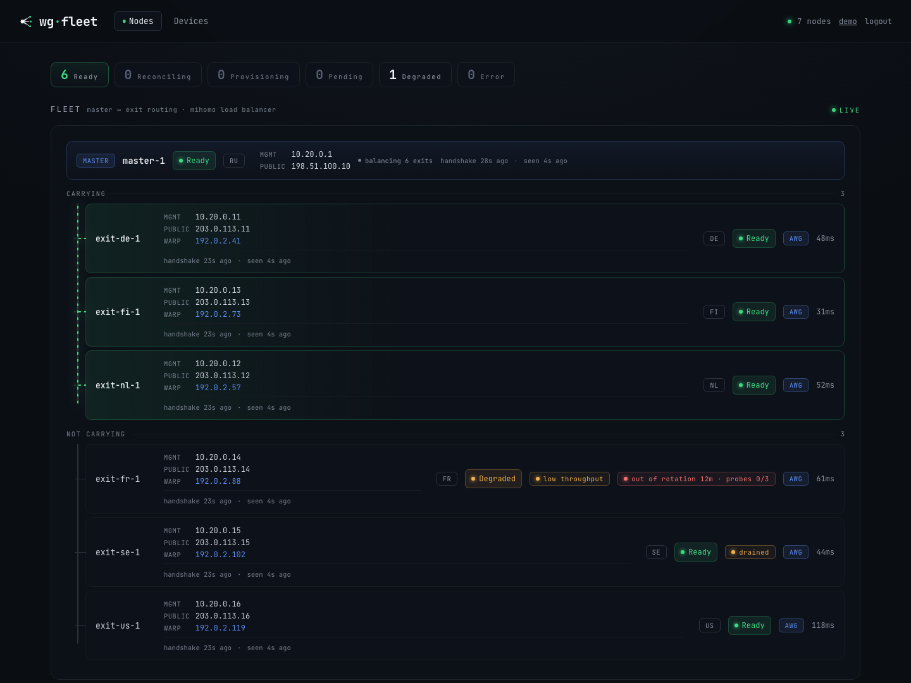
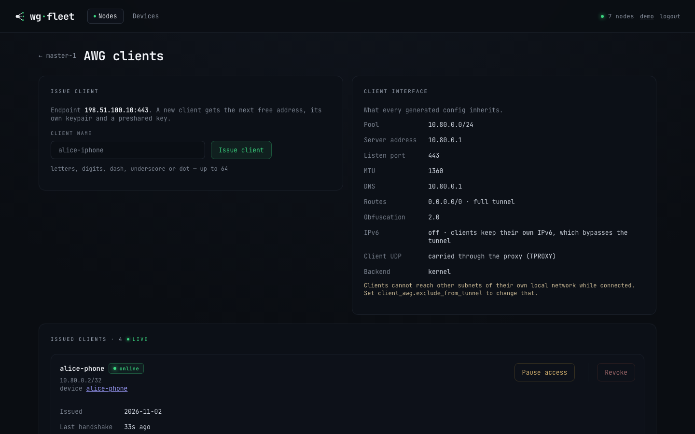
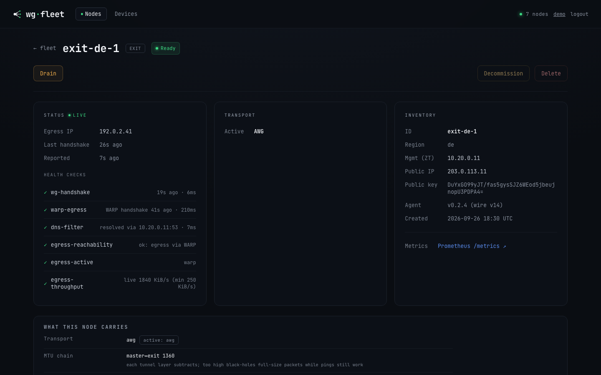

# Operations

Day-to-day fleet operation: planning changes, the dashboard, client access,
break-glass access, backup and restore, certificates, metrics, node health,
kernel and AmneziaWG module upgrades, and client interception in mihomo's
network namespace.

See also [cli.md](cli.md) for every flag and [upgrade.md](upgrade.md) for rolling
the agent binary forward.

---

## Dry-run everywhere

| Flag | Binary | Effect |
|---|---|---|
| `--plan` | agent | Render every config and the exact change set, write nothing. |
| `--provision … --plan` | controller | Render every config and the exact change set, write nothing. |

Plan output shows files (secrets redacted), commands, and DB updates.

## Web dashboard

`controller.webui` serves a fleet view. Bind it to the ZeroTier address.

```yaml
controller:
  webui: 10.20.0.10:9000        # mgmt/overlay address only
  session_ttl: 168h
fleet:
  masters:
    - name: master-1
      client_admin_ports: [9000]   # optional: reach it from the client pool too
```

All keys: [configuration.md#2-controller-the-controller-process](configuration.md#2-controller-the-controller-process),
[configuration.md#identity-and-exposure](configuration.md#identity-and-exposure)



| Surface | Shows |
|---|---|
| Fleet list | Per-state summary, live refresh, state badges. |
| Node detail | Inventory, latest status + health checks, rendered `NodeSpec` preview (AWG params, peers, routing, firewall, DNS, master data plane), and a version-skew badge when the agent's wire version is incompatible. |

Actions are confirmed POSTs with CSRF and same-origin checks.

| Action | Effect |
|---|---|
| **Provision** | SSH-bootstrap a `Pending` node asynchronously (Pending → Provisioning → Ready). |
| **Upgrade** | Roll the agent binary forward over SSH without tearing down the data plane. |
| **Drain** | Keep the node as a configured proxy but remove it from load-balance. Existing connections survive, no new traffic. |
| **Undrain** | Rejoin the load-balance group. |
| **Decommission** | The agent tears down the data plane on its next reconcile (stop services, clear routing/firewall, best-effort reverse reconcile) and destroys the node's WireGuard and REALITY private keys. A recommissioned node comes back with new ones and is re-peered from scratch. |
| **Delete** | Remove the exit from inventory AND from the manifest: its block in `fleet.exits`, plus its name in any `reserve_exits`. |
| **Download backup** | Export an age-encrypted archive of the controller (and co-located master) state. |

Delete does not revoke the certificate, but a deleted id is refused at
registration until you provision it again. Delete once the server is gone, or
stop its agent first. No client credential lives on an exit.

Drain, Decommission and Delete are **exits only**, enforced server-side. Undrain
and Recommission are not restricted, so a node carrying either flag always has a
way back from the console.

## Client credentials (AmneziaWG)



On a master with `client_awg.managed`, its node page has a **Client credentials**
panel.

```yaml
controller:
  client_portal: 10.20.0.10:9001               # optional self-service links
  client_portal_url: https://vpn.example.org
fleet:
  masters:
    - name: master-1
      client_awg:
        managed: true
        listen_port: 443
        address_pool: 10.80.0.0/24
```

All keys: [configuration.md#client_awg-the-client-facing-amneziawg-listener](configuration.md#client_awg-the-client-facing-amneziawg-listener),
[configuration.md#2-controller-the-controller-process](configuration.md#2-controller-the-controller-process)

| Action | Effect |
|---|---|
| **Issue** | Create a credential and open its card: `.conf`, QR, and a **self-service link** (a page carrying only that profile, reached over the tunnel or the portal address). Hand out the link rather than the file. |
| **Pause** | Reversible. The peer is removed from the interface and the self-service page says so. The same config works again on resume. |
| **Rename** | A label for you only. Nothing the person holds changes. |
| **Revoke** | Permanent. The credential and its key are deleted, and the only way back is a new profile. The console confirms on its own page. |

A VLESS credential (below) has no pause. Revoking is the only way to cut one off.

## The master is lost: reserve configs

An exit with `lifeline` carries a second client interface `awgl0` with the
master's credentials. Each credential gets a reserve profile per lifeline exit.
Hand them out **in advance**, because the console and the portal live on the
master.

```yaml
fleet:
  exits:
    - name: exit-a
      lifeline:
        listen_port: 41827
        address_pool: 10.90.0.0/24
        egress: direct
```

All keys: [configuration.md#lifeline](configuration.md#lifeline)

Tell the person to switch the app to the reserve profile they already imported,
and to switch back when the master returns. Reserve traffic uses that exit's
uplink (or WARP), without fleet routing, geo rules or failover.

| Surface | Where the reserve configs are |
|---|---|
| Console | node page → credential card → **RESERVE · if the main server stops working**, one `.conf` + QR per exit |
| Portal | the person's own page → **If the main server stops working** (ready exits only; hidden while paused) |

Console reasons when an exit is not ready:

| Reason | Fix |
|---|---|
| `the exit has not published its lifeline key yet` | Wait one reconcile pass. |
| `no public endpoint known for this exit` | Set `public_ip` on the exit. |
| Ready, but the profile never connects | Check the `Endpoint =` line of a downloaded reserve `.conf`. Unset `public_ip` falls back to `ssh.host`; if that was ever repointed at the management overlay, the profile carries an address no client can dial. Declare `public_ip`. |
| Connects, but nothing loads and DNS times out | Not the exit. On Linux, `wg-quick`/`awg-quick` routes the profile's own endpoint into the tunnel whenever `AllowedIPs` is a split list rather than `0.0.0.0/0` — `ip route get <endpoint>` shows the tunnel device and `ip rule` has no `fwmark`. Phones are unaffected. |
| `Reserve configs could not be listed: …` | Listing failed. Credentials and main configs still render. |

Check on the exit:

```bash
awg show awgl0                          # port, peers, handshakes
nft list table inet wgfleet | grep -E 'awgl0|<lifeline port>'   # accept, masquerade, leak guard
iptables -S DOCKER-USER | grep awgl0    # forward accepts
```

Health check `lifeline` on the node page, red with a reason (no key yet, spec
rejected, AmneziaWG 3.x refused by the module), means `awgl0` serves its last
good config, not the current spec.

Turning it off takes two reconcile passes. Pass 1 brings `awgl0` down and keeps
the config, pass 2 removes the config.

Retire a hand-built emergency interface before adding `lifeline` to an exit that
already has a hand-made `awgl0`:

```bash
systemctl disable --now awg-quick@awgl0
rm /etc/amnezia/amneziawg/awgl0.conf
rm -r /etc/systemd/system/awg-quick@awgl0.service.d
systemctl daemon-reload
```

Then add the `lifeline` section. The server key changes, so peers issued against
the old interface re-import the reserve profile from the console or the portal.

## Client access (VLESS)

On a master with `client_vless.enabled`, its node page has a **VLESS clients**
entry. Issue per-client credentials there and hand each user one of these.

```yaml
fleet:
  masters:
    - name: master-1
      client_vless:
        enabled: true
        route_through_cidrs: [10.20.0.0/16]   # internal nets clients tunnel to
```

All keys: [configuration.md#client_vless-dpi-resistant-client-transport](configuration.md#client_vless-dpi-resistant-client-transport)

| Handout | Notes |
|---|---|
| **Clash config (`.yaml`)** | The recommended client on macOS. It bakes in the proxy, tun `strict-route` (without it macOS leaves RFC1918 off the tunnel) and DNS pointed at the master's blocky over the tunnel. Import into **Clash Verge Rev** and enable Tun Mode. |
| **vless:// link / QR** | For v2rayTun and other clients. To reach internal networks in v2rayTun, also import the routing object (Routing → import from clipboard, `v2rayTun://import_route/…`, shown on the page). |
| **Subscription URL** | Carries the vless link and the routing rules in a `routing` response header. Reachable over the mgmt/ZT overlay. |

`client_vless.route_through_cidrs` in the manifest controls which internal
networks clients route through the tunnel.

## Break-glass: reaching a node you just cut off

Firewall, client-interface and NAT changes all land on the master, which is
usually the box you are connected *through*. **SSH over the ZeroTier mgmt
overlay survives every knob in the manifest.** Use the overlay, not the public
IP, as the escape hatch.

```yaml
fleet:
  mgmt_subnet: 10.20.0.0/16      # trusted by construction on every node
  exits:
    - name: exit-a
      firewall:
        whitelist: [198.51.100.0/24]
```

All keys: [configuration.md#3-fleet-fleet-wide-settings](configuration.md#3-fleet-fleet-wide-settings),
[configuration.md#firewall](configuration.md#firewall)

| Rule | Detail |
|---|---|
| Overlay accept | The input chain accepts `iifname "zt*"` ahead of `masters[].whitelist`, `public_udp_ports`, `public_tcp_ports` and the AS blacklist. |
| Leak guard | The egress leak guard cannot touch a master. |
| Public SSH port | Opened **after** the AS-blacklist drop, so direct SSH from a flagged address can be refused while the overlay still works. |

- **Keep a second SSH session open** on the master for the whole of any firewall,
  routing or client-interface change. Run `wgfleet-agent --once --plan` in it to
  see why the new state locked you out.
- **Reach an exit through the master** when its public path wedges: `ssh <master>`,
  then `ssh root@<exit-mgmt-addr>`.
- **Have provider console access ready** (VNC/serial) before touching the
  master's firewall.

The agent keeps its **last-good spec** on disk at `/var/lib/wgfleet/last-spec.json`
(0600). A controller that is down or refusing a bad manifest does not take the
data plane with it, and a node that reboots in that window comes back converged
(nftables, interfaces, routing).

| See | Meaning |
|---|---|
| A node goes stale in the console and in `wgfleet_node_last_report_age_seconds` while healthy | It runs from the cache and reports nothing. Its log says `converging on the last-good spec instead of standing still`. |
| The controller answers and refuses: a deleted node, a revoked certificate, a wire-version mismatch | The refusal is obeyed. A node you deleted does not rebuild itself. |

The fallback happens only when NOTHING ANSWERED, meaning a dial failure or a
timeout.

## A node changed its public address

The address the fleet dials is declared in the manifest and nowhere else. A move
is a manifest edit plus a controller restart, with no re-provisioning.

```yaml
fleet:
  exits:
    - name: exit-a
      public_ip: 198.51.100.7    # the endpoint the master dials
      ssh:
        host: 198.51.100.7       # public_ip defaults to this
```

All keys: [configuration.md#identity-and-egress](configuration.md#identity-and-egress)

1. Edit the node's entry.
2. Restart the controller. It reads the manifest once at startup and never
   reloads it.
3. Wait for two reconcile passes (~60 s at the default 30 s interval). The master
   re-renders the tunnel at the new endpoint and re-dials, then the exit sees the
   fresh handshake and leaves **Degraded**.

| Role | Key | Rules |
|---|---|---|
| Exit | `public_ip` when set, otherwise `ssh.host` (its default) | Set both if SSH and the tunnel should go to different addresses. The value must be an IP literal; a DNS name is skipped and the next source is used. |
| Master | `public_ip`, and only that | It does not fall back to `ssh.host` (often the management overlay, which must never reach a client profile). A master with no `public_ip` has no endpoint to hand out and the client pages say so. A master's `public_ip` may be a DNS name, and [master-migration.md](master-migration.md) recommends one. |

If it was the **master** that moved, client profiles already handed out still
carry the old endpoint. Re-issue them and have each device re-import.

## Support bundle

A read-only, plain-text diagnostic archive with no secrets, for handing a broken
fleet to someone with no access to it. Full runbook:
[support-bundle.md](support-bundle.md).

```bash
# One node. Depends on nothing — this works when the control plane is down.
wgfleet-agent --support-bundle --note "clients stopped resolving around 14:00"

# The exits, plus a fleet inventory. Needs a live controller and SSH.
wgfleet-controller --support-bundle --fleet
```

Read it before sending it.

| Need | Do |
|---|---|
| List the archive | `tar tzf <archive>` |
| Extract it | `tar xzf <archive>` |
| See every file and what was **not** collected | Read `MANIFEST.txt` inside it. |
| The tool refuses to write the archive | Report the refusal rather than working around it. |
| The master is the problem | `--fleet` collects only one inventory line about the co-located master, so run the agent bundle on the master too. |
| The problem is client-side | Run `client-diag.sh` from the client. |

## Backup & restore

One command captures the **irreplaceable** state and one restores it onto a fresh
node. Everything else (nft, mihomo/xray/blocky configs, compose files) is
regenerated by the agent's reconcile loop and is not captured.

```yaml
controller:
  store: /var/lib/wgfleet/state.db
  pki:
    ca_key: file:///etc/wgfleet/ca.key   # a file travels in --backup, secret:// does not
```

All keys: [configuration.md#2-controller-the-controller-process](configuration.md#2-controller-the-controller-process)

```bash
# Export (controller may stay live; the db snapshot is WAL-consistent).
wgfleet-controller --backup fleet.tar.age --age-recipient age1...
#   ...or without --age-recipient to be prompted for a passphrase.

# Restore onto a fresh node (controller MUST be stopped). --plan shows the change set.
# An archive written with --age-recipient needs --age-identity on BOTH lines.
wgfleet-controller --restore fleet.tar.age --age-identity key.txt --plan
wgfleet-controller --restore fleet.tar.age --age-identity key.txt
#   ...drop --age-identity for a passphrase-encrypted archive; age prompts for it.
```

Captured:

| Item | When |
|---|---|
| The store db, a `VACUUM INTO` snapshot | always |
| The CA cert + key | always |
| `controller.yaml` | always |
| The sops secrets file | when configured |
| The fleet secret `awg3.key` | always |
| The master's own AmneziaWG key | when this node is also a master |
| The client-interface key | when this node is also a master |
| The client-facing VLESS/REALITY key | when this node is also a master |
| The wg-easy client db and admin password | where wg-easy is still in use |
| The node identity `node.crt` / `node.key` / `agent.yaml` | when this node is also a master |

**Six private keys** in one envelope: store it like a secret.

Two things are neither captured nor regenerable, and the archive says so on every
run. Copy them somewhere the master is not.

| Item | Path | Without it |
|---|---|---|
| The SSH private keys the exits are provisioned with | `exits[].ssh.key_path`; only the paths travel | A restored controller cannot provision, upgrade or roll back any exit. |
| The ZeroTier identity | `/var/lib/zerotier-one/` | The node cannot rejoin as the SAME mgmt address. |

A secret the controller cannot put in the archive is warned about **before** the
archive is written, on the console's Backup button and the CLI: a `pki.ca_key`
behind `env://` or `secret://`, an `awg3_key` that is not a file, or either at a
path this host cannot read. **Treat that warning as a failed backup.** Without
the CA a rebuilt host cannot issue or renew any certificate, and every node falls
off the control plane as its certificate expires.

Restore checks every destination **before it writes anything**, moves each
existing file aside to `<path>.bak-<timestamp>`, and writes atomically, only
where this host's `controller.yaml` says its files live and with this host's own
permissions. A rejected archive leaves the box unchanged. It removes a stale
SQLite write-ahead log beside a restored database, and refuses to run while a
controller is still serving on the configured endpoint.

Agents dial `controller: <mgmt>:8443`. To migrate, rejoin ZeroTier on the new
node as the **same mgmt address** and the fleet re-adopts itself. If the mgmt
address changes, update every node's `agent.yaml` `controller:` and re-issue the
server cert SAN; restore prints this reminder.

## Certificates

Every node authenticates to the controller with an mTLS certificate issued for a
year. **Agents renew their own** between 70% and 90% of that, in place, over the
control plane, with no restart. The moment is spread per node name.

| See | Meaning |
|---|---|
| `wgfleet_agent_cert_expiry_timestamp_seconds` stops going up | Renewal is failing on that node. |
| `WgfleetNodeCertExpiring` fires | Renewal has been failing for at least forty days. |

Usual causes: the node was offline, the controller has no CA loaded, or a clock
is wrong.

```bash
# What THIS host holds: the fleet CA and, on a co-located master, the local agent's certificate.
wgfleet-controller --certs check-expiration
```

Other nodes' certificates are on those nodes.

An expired certificate cannot renew itself, because renewal travels over the
mTLS channel it opens. Use the out-of-band path:

```bash
sudo wgfleet-controller --certs renew --node exit-de-1
```

It writes `pki/exit-de-1/node.{crt,key}` and prints the scp/ssh lines for that
node from the manifest. Delete the local copy afterwards.

There is no CRL: the old certificate stops being useful when it expires. A node
that has left the fleet (`Decommission`, or deleted) is refused renewal, and that
is the only revocation this system has.

## Metrics

The controller (`controller.metrics`) and every agent expose Prometheus text on
the ZeroTier address only.

```yaml
controller:
  metrics: 10.20.0.10:9300     # controller.yaml
agent:
  mgmt_addr: 10.20.0.11        # agent.yaml; binds /metrics on <mgmt_addr>:9301
```

All keys: [configuration.md#2-controller-the-controller-process](configuration.md#2-controller-the-controller-process),
[configuration.md#8-agentyaml-per-node-agent](configuration.md#8-agentyaml-per-node-agent)

| Knob | Effect |
|---|---|
| default | The agent endpoint is **on** at `<mgmt_addr>:9301`, from `agent.mgmt_addr`. |
| `--metrics <addr>` | Override the bind. |
| `--metrics off` | Disable it. |

**Controller** (a scrape-time projection of the state store):

```
wgfleet_nodes{state="Ready"}                               # node count per lifecycle state
wgfleet_node_info{node,role,region,state}                  # inventory info (=1)
wgfleet_node_agent_info{node,agent_version,wire_version}   # agent build + wire version (=1)
wgfleet_node_last_report_age_seconds{node}                 # since last status report
wgfleet_node_reconcile_failed{node}                        # 1 if last reconcile errored
wgfleet_node_health_check{node,check}                      # 1 ok / 0 failing
wgfleet_node_egress_info{node,egress_ip}                   # observed egress IP (=1)
wgfleet_node_drain{node}                                   # 1 if administratively drained (out of LB)
wgfleet_node_decommission{node}                            # 1 if flagged for decommission (data plane torn down)
wgfleet_node_client_vless_clients{node}                    # VLESS/REALITY clients issued on a master
```

**Agent** (its own reconcile/health counters):

```
wgfleet_agent_reconcile_total{result}              # success | error
wgfleet_agent_reconcile_duration_seconds           # histogram
wgfleet_agent_state_info{state}                    # current lifecycle state (=1)
wgfleet_agent_health_check{check}                  # 1 ok / 0 failing
wgfleet_agent_drift_total{component}               # count of unexpected config changes (drift-repairs)
wgfleet_agent_egress_active{method}                # current active egress method (e.g. warp, direct)
wgfleet_agent_egress_reachability{state}           # ok | degraded | blocked (censorship signal)
wgfleet_agent_start_time_seconds                   # for uptime
```

## Node lifecycle & health



After each apply reconcile the agent runs role-specific self-checks and reports
the derived state.

```yaml
controller:
  staleness_after: 3m
fleet:
  exits:
    - name: exit-a
      drain: false
      min_egress_throughput_kbytes: 0   # 0 inherits the fleet floor
```

All keys: [configuration.md#2-controller-the-controller-process](configuration.md#2-controller-the-controller-process),
[configuration.md#identity-and-egress](configuration.md#identity-and-egress)

| Role | Check | Notes |
|---|---|---|
| Exit | `wg-handshake` | The freshest handshake must be under 3 m. An older handshake means the tunnel has stopped carrying traffic even though the interface is up. |
| Exit | `egress-reachability` | Reports ok, degraded or blocked. |
| Exit | `warp-egress` | Runs when `egress=warp`. |
| Exit | `dns-filter` | — |
| Exit | `lifeline` | Runs when the exit has a `lifeline`. Red with a reason ⇒ `awgl0` serves its last good config, not the current spec. |
| Master | `client-wg` | The client interface is up. |
| Master | `mihomo-api` | The Clash API `/version` answers. |
| Master | `client-vless` | Runs when `client_vless.enabled`. The VLESS+REALITY inbound is up; a down inbound shows **Degraded**. |

| Condition | Reported state |
|---|---|
| Reconcile failed | **Error** |
| All checks pass | **Ready** |
| Any check fails | **Degraded** |
| No checks | **Reconciling** |

If an agent goes silent, the controller's **staleness sweep** demotes its node
(`Ready`/`Reconciling`) to **Degraded** after `controller.staleness_after`
(default 3 m; `<0` disables). `Error` nodes keep their failure reason. When the
agent recovers, its next report restores the state.

## Kernel upgrades (your call, not ours)

AmneziaWG is a DKMS module built for a specific kernel. A node that reboots into
a kernel the module was never built for (headers missing at install time, or a
kernel API change) has no tunnels. wgfleet does **not** hold kernel packages,
touch unattended-upgrades or reboot nodes.

- After any reboot, check the module came back with `modinfo amneziawg` on the
  node, or that the node returns to Ready.
- Keep `linux-headers-generic` installed alongside the kernel metapackage.
- To make kernel upgrades deliberate, hold the metapackage:
  `apt-mark hold linux-image-generic linux-headers-generic`. Check the name first
  (`linux-image-virtual`, `linux-image-kvm` exist on other images). `apt-mark
  hold` on a package that is not installed succeeds and appears in
  `apt-mark showhold` while holding nothing.
- A provider image with no kernel metapackage, only a versioned
  `linux-image-6.x`, receives no kernel upgrades on its own: safe for the module,
  no kernel security updates either.

The one apt hold wgfleet keeps is on `amneziawg`, `amneziawg-dkms` and
`amneziawg-tools`. Tools and module must stay on the same AmneziaWG generation or
`awg setconf` fails and the interface never comes up. The hold blocks automatic
upgrades only; the agent re-establishes it at whatever version you chose.

### Upgrading the AmneziaWG module

Neither a wgfleet upgrade nor a re-run of `prepare-node.sh` touches the module. A
node on a 1.x module keeps working, and a 2.0 config runs on either generation.
You need a newer module only when you turn on `awg3` (the agent refuses the
config and says so in the reconcile error) or when upstream fixes something you
are hitting.

```yaml
fleet:
  awg3: true                                # master<->exit tunnels on 3.0
  awg3_key: file:///etc/wgfleet/awg3.key
  exits:
    - name: exit-a
      awg3: false                           # per-exit override
```

All keys: [configuration.md#3-fleet-fleet-wide-settings](configuration.md#3-fleet-fleet-wide-settings),
[configuration.md#amneziawg-30](configuration.md#amneziawg-30)

```bash
prepare-node.sh --upgrade-awg
```

That installs `amneziawg-dkms` and `amneziawg-tools` together, then reloads the
module, which deletes every AmneziaWG interface on the node. The agent rebuilds
them on its next pass, a few seconds of loss. By hand:

```bash
apt-get update
apt-get install -y --allow-change-held-packages amneziawg-dkms amneziawg-tools
modprobe -r amneziawg && modprobe amneziawg   # or reboot
modinfo -F version amneziawg                  # 3.1.… for the current line
```

Do **not** `apt-mark unhold` first. The agent re-pins the packages every reconcile
pass (about every 30 s) and `apt-get install -y` fails with "Held packages were
changed". `--allow-change-held-packages` moves both packages as one transaction
and the agent re-pins the new version.

On a master whose clients are still served by wg-easy (see
[client-migration.md](client-migration.md)), watch the container, not the
interface.

| Fact | Detail |
|---|---|
| wg-easy v15.3.0 bundles generation-1 tools | On a 3.x module its `awg-quick up wg0` fails with `Unable to modify interface: Invalid argument`. |
| Agent v0.2.4 or newer | Recreates wg-easy from v15.4.0 (generation-3 tools) within one pass of the reload. Do not `docker restart` it by hand in between. |
| Older agent | The way out is client-migration.md, parts 2-3. |
| Once v15.4.0 has run | Do **not** take the module back to 1.x: it migrated wg-easy's database forward and v15.3.0 will not open it. |

If the DKMS build itself fails, the reason is in
`/var/lib/dkms/amneziawg/1.0.0/build/make.log`, usually the kernel. Ubuntu
22.04's GA kernel is 5.15 and upstream builds have broken on pre-6.7 kernels.
Moving to the HWE kernel (`linux-generic-hwe-22.04`) is the cheap way out, and
the package decision is yours.

### AmneziaWG is down: where to look

Three places on the node, in this order. None of them is `awg-quick@`, because
the agent never installs that unit.

```bash
journalctl -u wgfleet-agent -b --no-pager | grep -i -E 'error|warn|awg|wg0' | tail -30
ip -br link | grep -E 'wg|awg'
docker ps -a --format '{{.Names}} {{.Status}}'        # master: is wg-easy up and healthy?
```

`wg0 not found` in a health check is the agent NOTICING the interface is gone,
not failing to create it. On a master still on wg-easy the creator is the
container, and its reason is in `docker logs --tail 40 wg-easy`. On an exit the
interface is `awg0`, the agent raises it, and the failing `awg-quick up` is in
the journal with its output.

Check the versions first; two of the causes below are version splits:

```bash
nft --version                           # 1.0.2 on Ubuntu 22.04, 1.0.9 on 24.04
modinfo -F version amneziawg; awg --version
```

Causes, in order of likelihood:

| Symptom | Look at | Do |
|---|---|---|
| `awg setconf … Invalid argument` | Compare `modinfo -F version amneziawg` with `awg --version` on the host and, on a wg-easy master, inside the container (`docker exec wg-easy awg --version`). | The major versions must agree. See the section above. |
| `dkms status` has no `installed` line for `uname -r` | The module was not built for the running kernel. | See "Kernel upgrades" above. |
| The move into mihomo's namespace reverts every time and probes say "connection refused" | `nft rejects the rendered ruleset` in the agent journal, and `nft list table ip wgfleet_master` for a `dnat to <gateway>:7895` line while mihomo's network mode is `container:…`. | The host is still intercepting clients after mihomo left. Requires agent v0.2.4 or newer on nftables 1.0.2 (Ubuntu 22.04). |
| The interface is back but `udp-return-path` keeps failing | `client interception not moving … reverted 3 times` in the journal. | The namespace mover gave up while the interface was down. On an agent older than v0.2.4, toggle `mihomo.client_via_netns` to `off`, wait a pass, and back to `auto`. |

When it is none of those, take a support bundle
(`wgfleet-agent --support-bundle --note "..."` on the node) and send it.

## Client interception in mihomo's network namespace

mihomo runs in its own network namespace so its transparent-proxy reply sockets
cannot collide with UDP ports the host already holds (the client AmneziaWG port,
for one), a collision that silently black-holes client traffic to that port.

```yaml
fleet:
  masters:
    - name: master-1
      mihomo:
        client_via_netns: auto            # off | auto
        netns_cidr: 100.127.255.0/30
```

All keys: [configuration.md#mihomo-the-master-data-plane](configuration.md#mihomo-the-master-data-plane)

### The knob

`fleet.masters[].mihomo.client_via_netns`:

| value | meaning |
|---|---|
| unset | `auto` (the default) |
| `off` | interception stays on the host |
| `auto` | every client moves, once the agent has proved the namespace works |

There is no per-client mode: mihomo moves as a whole, so a CIDR here is refused.
The unit of staging is the NODE. Any other value is refused with an error naming
the knob.

**It ships on.** Before moving anything the agent proves the namespace resolves
and reaches an exit; after the move it measures the client path from its own
synthetic client and reverts itself if that path breaks. `off` is a full,
converging way back. The move does not start on a master where wg-easy still owns
the client interface (see [client-migration.md](client-migration.md)).

Run a canary on one device for a day before `auto`.

### After switching it on, WATCH — do not just look

Every point-in-time check can be green while the migration is failing.

| Failure | What it looks like |
|---|---|
| A self-heal probe restarting mihomo on every pass | Each restart re-initialises its userspace WireGuard devices and drops exits out of the balancer. |
| A veth narrower than the uplink | 148-byte handshakes pass, every tunnel reports UP, nothing bigger gets through. |

Take a baseline first, then watch:

```bash
./netns-move-check.sh --baseline     # BEFORE the flip
# ... set client_via_netns: auto, restart the controller ...
./netns-move-check.sh 180            # AFTER
```

It fails on a mihomo that restarts, on a self-heal being throttled, on a packet
the size of the uplink not leaving the namespace, on mihomo in an orphaned
namespace, on an unreachable control API, and — compared against the baseline —
on any tunnel that was alive before the move and is not after.

The control API keeps its address across the move: a redirect on the management
overlay sends it into the namespace, so `http://<mgmt>:9090/ui` works either way.

### How to tell where a master is

```bash
# The decision machine, from the agent's metrics.
curl -s <mgmt>:9301/metrics | grep netns_move
#   wgfleet_agent_netns_move_state{state="attached"} 1
#   wgfleet_agent_netns_move_attempts 0

# The kernel's version of the same question.
ip rule list | grep -E '^(390|400):'      # exemptions, then the move itself
ip route show table 51822                 # default via the veth
nsenter --net=$(docker inspect -f '{{.State.Pid}}' wgfleet-netns | sed 's|^|/proc/|;s|$|/ns/net|') nft list table ip wgfleet_netns

# Where mihomo actually is (not where compose says it should be).
readlink /proc/$(docker inspect -f '{{.State.Pid}}' mihomo)/ns/net
readlink /proc/$(docker inspect -f '{{.State.Pid}}' wgfleet-netns)/ns/net
```

Clash API moves with mihomo: once attached it is on the namespace end of the veth
(`100.127.255.2:9090` by default), not on the management address.

### How to go back

Set `client_via_netns: off` and let the agent converge. It withdraws the routing
rule, the destination exemptions and the namespace route table, and mihomo
returns to host networking. By hand, on the master, when the agent is not
running:

```bash
ip rule del pref 400                       # stop routing clients into the namespace
while ip rule del pref 390 2>/dev/null; do :; done   # the direct exemptions
ip route flush table 51822
docker compose -f /etc/wgfleet/docker-compose.yml up -d --force-recreate mihomo
nft -f /etc/wgfleet/wgfleet-master.nft     # re-arm the host interception
```

The rule at priority 400 sorts ahead of the TPROXY mark rule. Left in place after
mihomo has moved back, marked client packets go into an empty namespace. Remove
it first.

### Downgrading the binary after a move

An agent old enough not to know about the namespace will not remove the ip rules,
and `docker compose up -d` leaves the holder running as an orphan. **Revert with
the knob and let the current agent converge before rolling the binary back.**

### The alert that will be standing

`WgfleetClientUDPBlackHole` is a warning, not a page. On a master that still
intercepts on the host it stands for every UDP port the host holds and clears
when the interception moves, or the port is freed, or the traffic is refused. The
user-visible outage has its own critical alert, `WgfleetClientPathDead`.

Before rolling this out to a master, take the inventory the check will read:

```bash
ss -lunp        # every UDP port this host holds is a black hole today
```
