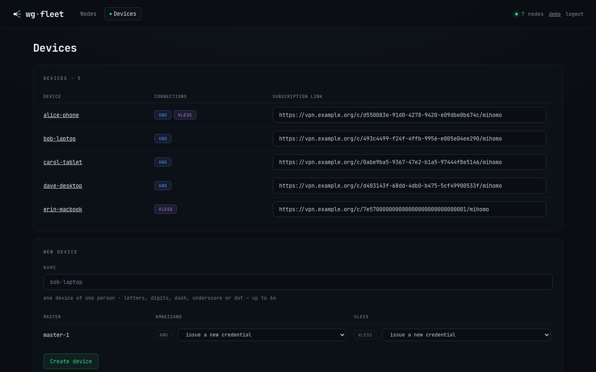
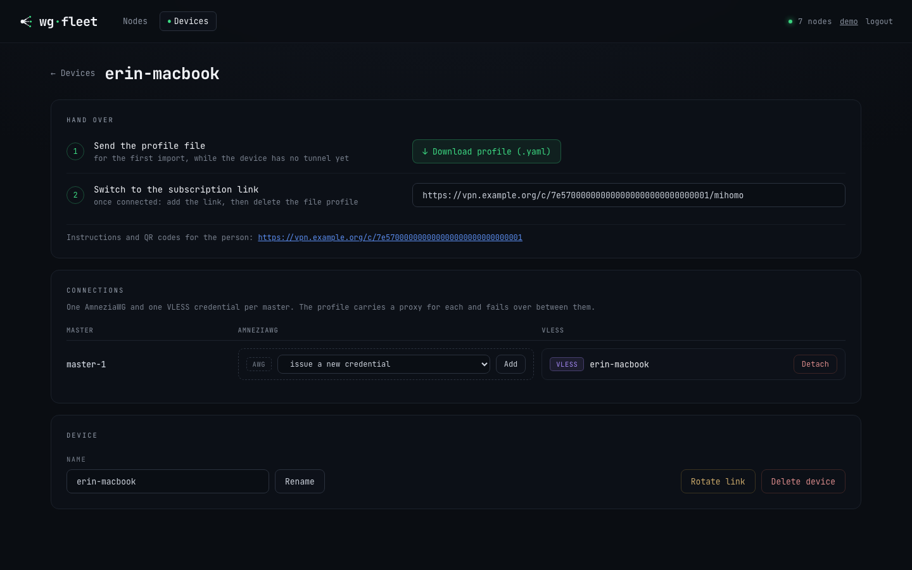
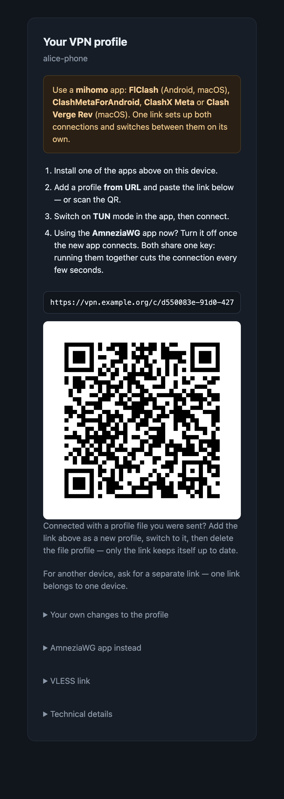

# Operations

Day-to-day fleet operation: planning changes, the dashboard, client access,
break-glass access, backup and restore, certificates, metrics, node health,
kernel and AmneziaWG module upgrades, and client interception in mihomo's
network namespace.

See also [cli.md](cli.md) for every flag and [upgrade.md](upgrade.md) for rolling
the agent binary forward.

---

## Dry-run everywhere

| Flag | Binary | Effect |
|---|---|---|
| `--plan` | agent | Render every config and the exact change set, write nothing. |
| `--provision … --plan` | controller | Render every config and the exact change set, write nothing. |

Plan output shows files (secrets redacted), commands, and DB updates.

## Web dashboard

`controller.webui` serves a fleet view. Bind it to the ZeroTier address.

```yaml
controller:
  webui: 10.20.0.10:9000        # mgmt/overlay address only
  client_portal: 10.20.0.10:9001
  session_ttl: 168h
fleet:
  masters:
    - name: master-1
      client_admin_ports: [9001]   # optional: reach the portal from the client pool too
```

Any port listed in `client_admin_ports` is reachable by every client credential holder
(AWG and VLESS alike) — list the portal port there, not the Web UI's, unless client
access to the admin panel itself is intended.

All keys: [configuration.md#2-controller-the-controller-process](configuration.md#2-controller-the-controller-process),
[configuration.md#identity-and-exposure](configuration.md#identity-and-exposure)


| Surface | Shows |
|---|---|
| Fleet list | Per-state summary, live refresh, state badges. |
| Topology | The master trunk, then exits split into **CARRYING** (members of the tier the master routes through) and **NOT CARRYING**, each not-carrying exit with the master's verdict on the tunnel to it (below). |
| Node detail | Inventory, latest status + health checks, rendered `NodeSpec` preview (AWG params, peers, routing, firewall, DNS, master data plane), a version-skew badge when the agent's wire version is incompatible, and the same verdict badge beside the state pill. |

Why an exit is not carrying — the badge on its card and on its node page:

| Badge | Means |
|---|---|
| **out of rotation `12m` · probes `0/3`** | The master's own multi-destination probe judged this tunnel unusable and pulled the exit out of the load balancer `12m` ago; the last pass reached 0 of the 3 destinations it sampled. The first exit a pass samples is asked twice before it is pulled out; a pass that answers on the second ask logs `exit failed one probe and answered the re-ask` and keeps the exit. |
| **check failed · paused** | Shown in **CARRYING**, not under NOT CARRYING: a member of the carrying tier whose last load-balancer health check failed. It carries no traffic until the next check passes, so its link stops animating, but it has not left the tier. Several failed probes in a row turn this into **out of rotation**. |
| **no usable path · probes `0/3`** | A member of the idle reserve tier the last warm probe could not reach the internet through. It carries nothing today, so this is not an outage — it means failing over to it would restore nothing. |
| no badge | Nobody judged this exit: it is carrying, or it sits behind the member the reserve scan stopped at. Absent evidence, not evidence of health. |

**Ready** next to **out of rotation** is not a contradiction: the state pill reports
the node's own self-checks, the badge reports the master's ability to route through
it. The same verdicts are exported as `wgfleet_agent_exit_held_out` and
`wgfleet_agent_standby_tier_member_usable`, with alerts in the archive's
`monitoring/`. A hold-out shorter than a scrape interval shows only in
`wgfleet_agent_exit_holdouts_total` (one per hold-out); `WgfleetExitFlapping` fires at
two in 6 h.

Actions are confirmed POSTs with CSRF and same-origin checks.

| Action | Effect |
|---|---|
| **Provision** | SSH-bootstrap a `Pending` node asynchronously (Pending → Provisioning → Ready). |
| **Upgrade** | Roll the agent binary forward over SSH without tearing down the data plane. |
| **Drain** | Keep the node as a configured proxy but remove it from load-balance. Existing connections survive, no new traffic. |
| **Undrain** | Rejoin the load-balance group. |
| **Decommission** | The agent tears down the data plane on its next reconcile (stop services, clear routing/firewall, best-effort reverse reconcile) and destroys the node's WireGuard and REALITY private keys. A recommissioned node comes back with new ones and is re-peered from scratch. |
| **Delete** | Remove the exit from inventory AND from the manifest: its block in `fleet.exits`, plus its name in any `reserve_exits`. |
| **Download backup** | Export an age-encrypted archive of the controller (and co-located master) state. |

Delete does not revoke the certificate, but a deleted id is refused at
registration until you provision it again. Delete once the server is gone, or
stop its agent first. No client credential lives on an exit.

Drain, Decommission and Delete are **exits only**, enforced server-side. Undrain
and Recommission are not restricted, so a node carrying either flag always has a
way back from the console.

## Client credentials (AmneziaWG)


A master's node page has a **Client credentials** panel.

```yaml
controller:
  client_portal: 10.20.0.10:9001               # optional self-service links
  client_portal_url: https://vpn.example.org
fleet:
  masters:
    - name: master-1
      client_awg:
        listen_port: 443
        address_pool: 10.80.0.0/24
```

All keys: [configuration.md#client_awg-the-client-facing-amneziawg-listener](configuration.md#client_awg-the-client-facing-amneziawg-listener),
[configuration.md#2-controller-the-controller-process](configuration.md#2-controller-the-controller-process)

| Action | Effect |
|---|---|
| **Issue** | Create a credential and open its card: `.conf`, QR (only when the profile fits in one — an AmneziaWG profile does not), and a **self-service link** (a page carrying only that profile, reached over the tunnel or the portal address). Hand out the link rather than the file. |
| **Pause** | Reversible. The peer is removed from the interface and the self-service page says so. The same config works again on resume. |
| **Rename** | A label for you only. Nothing the person holds changes. |
| **Revoke** | Permanent. The credential and its key are deleted, and the only way back is a new profile. The console confirms on its own page. |

A VLESS credential (below) has no pause. Revoking is the only way to cut one off.

## Client devices

A device is one physical device of one person. Its link serves a mihomo profile with a proxy for every credential it holds: AmneziaWG and VLESS, on every master.

Console: **Devices** in the top bar.





Prerequisites:

| Need | Why |
|---|---|
| The portal port is in `client_admin_ports` | Otherwise a device can never reach `/c/<token>` or `/c/<token>/mihomo` to fetch its profile, on either transport. |
| `client_awg.route_through_cidrs` requires `client_awg.exclude_from_tunnel` | The controller refuses the config without it (validation) — a route only makes sense as an exception to something already excluded from the tunnel. |
| `client_vless.route_through_cidrs` has no such requirement | It feeds the same device-profile routing rules as the AWG list, but the VLESS transport has no `exclude_from_tunnel` of its own to require it against. |

| Action | Effect |
|---|---|
| **Create** | New device. Per master: issue a new AWG / VLESS credential (default), attach an unattached one, or `none`. |
| **Add** | Empty slot on the device page: issue a new credential or attach an unattached one. Attaching kills the credential's own personal link (`/c/<credential-id>`) for good; the console asks first. An occupied slot offers only **Detach**. |
| **Detach** | Empty the slot. The credential stays on its master without a personal link. A device whose link was that credential's ID gets a new link. |
| **Rotate link** | New link; the old link and subscription stop at once. Credentials unchanged. |
| **Delete** | Removes the device and its link for good. Credentials stay, unattached, without personal links. |

Limits: one AWG and one VLESS credential per master per device. One AWG credential belongs to one device.

| Link | Content |
|---|---|
| `<client_portal_url>/c/<token>` | Page: subscription link + QR, AmneziaWG `.conf`, `vless://`, reserve configs |
| `<client_portal_url>/c/<token>/mihomo` | Profile, `text/yaml`, `Profile-Update-Interval: 24` |
| `<client_portal_url>/c/<token>/mihomo/qr` | QR of the subscription link (not of the profile) |
| `<client_portal_url>/c/<token>/config`, `/qr`, `/l/<exit>/…` | AmneziaWG `.conf`, its QR, reserve configs. `404` on a device without an AWG credential. `/qr` answers `404` when the profile is too large for a QR code — an AmneziaWG profile with the QUIC cover is; hand out the file |

Without `controller.client_portal_url` the link uses the portal's bind address.

Tested apps (mihomo core ≥ 1.19.30):

| App | Platform |
|---|---|
| FlClash | Android, macOS |
| ClashMetaForAndroid | Android |
| ClashX Meta | macOS |
| Clash Verge Rev | macOS |

First import (the portal is reachable only through the tunnel):

| Step | Who | Action |
|---|---|---|
| 1 | Operator | Device page → **Download profile (.yaml)**; send the file to the person. |
| 2 | Person | In the app: import the file, switch on TUN, connect. |
| 3 | Person | Open the device link, add the subscription link as a new profile from URL, switch to it. |
| 4 | Person | Delete the file profile. It never updates itself. |

Devices that can already reach the portal skip steps 1–2: add the profile from URL, switch on TUN, connect.

{ width="320" loading=lazy }

One app per device. The AmneziaWG `.conf` and the subscription's `<master>-awg` proxy carry the **same key**; with both running, the master answers whichever sent last and the tunnel breaks every few seconds. A mihomo app does this even with TUN off: its health check brings the AWG proxy up.

Local changes to the profile:

| Where the change is made | After a subscription update |
|---|---|
| Inside the subscription profile | Lost: the profile is replaced whole |
| Clash Verge Rev: the profile's **Merge** / **Script**, or its Rules / Proxies / Groups editors | Kept, applied on top of every update |
| Own local profile with the device link as a `proxy-providers` entry | Kept; proxies update, rules and DNS are the person's own and no longer follow the fleet |

| Profile part | Value |
|---|---|
| Proxies | `<master>-awg`, `<master>-vless` for each attached, active credential |
| `<master>-awg` with `client_awg.awg3` | `timers`: `version: 3` and the 3.x timers. `full`: also `header-protection-key` |
| `<master>` | `fallback` over that master's proxies; `https://www.gstatic.com/generate_204` every 300 s |
| `auto` | `fallback`: every master's `<master>-awg` in manifest order, then every `<master>-vless`; `https://www.gstatic.com/generate_204` every 60 s, and at once after 5 failed connections through the selected proxy |
| `wgfleet` | `select`: `auto` or any proxy |
| `<site>-auto` (per `fleet.client_sites` entry with `probe_url`) | `fallback`: `DIRECT`, `wgfleet`, checked against `probe_url` |
| `<site>` | `select`: `<site>-auto` (when present), `DIRECT`, `wgfleet` — the person's override |
| Rules | each proxy's own server — its address, port and network (UDP for `<master>-awg`, TCP for `<master>-vless`) → `DIRECT` first; each site's `cidrs` → `<site>`; then `route_through_cidrs` (both transports, every master — keep the lists identical across masters) and `mgmt_subnet` → `wgfleet`; the master's client pool → `<master>`; RFC1918, link-local, loopback → `DIRECT`; rest → `wgfleet` |
| DNS | each master's client resolvers, `tcp://<addr>:53` through `<master>`; absent when the master has none |
| DNS mode | `enhanced-mode: fake-ip` with `fake-ip-filter-mode: rule` and `MATCH,real-ip`: every name gets its real address, no `198.18.x` placeholders |
| IP rules | without `no-resolve`: a name is resolved through the tunnel and routed by its real address. The proxy-server rules carry `no-resolve`; a proxy whose endpoint is a name gets none |

Symptoms:

- Page says **paused** — every credential of the device is paused, or none is attached.
- **Something is wrong on our side** — a credential is active but its master has no published key or endpoint yet.
- **This link is no longer working** — the link was rotated, the device deleted, or the credential attached to a device.
- Profile never changes after a fleet update — the person is still on the file profile (step 4 skipped).
- One master's proxies missing from the profile — that master was not ready when the profile was fetched; update the profile in the app.
- No AmneziaWG block on the page, `/config` answers `404` — the device holds no AWG credential (VLESS only).
- Profile never refreshes while on AWG — `client_awg.exclude_from_tunnel` takes the client portal (or the mgmt overlay it binds on) out of AllowedIPs, so a device that has fallen back to AWG can never dial the portal to fetch its subscription. The controller logs a WARN naming the master and the uncovered range at startup; fix by adding it to `client_awg.route_through_cidrs`.
- Internal names do not resolve — check `dns_filter` on the master and the blocky mapping.
- macOS: the system DNS reads `114.114.114.114` while TUN is on — expected. Clash Verge Rev sets it under `enhanced-mode: fake-ip` so the OS resolver's queries enter the tun; it restores the previous DNS when TUN goes off. `dig`/`nslookup` still show real addresses: the query is answered by the fleet resolver through the tunnel.
- macOS: `nslookup` answers from the router's DNS (`Server:` is the router) — the profile was fetched before the `fake-ip` switch; update it in the app; if `scutil --dns` still shows the router, toggle TUN off and on.
- `nslookup` answers `198.18.x` — the profile predates `MATCH,real-ip`; update it in the app.
- Names of the network the device sits on (router, printer, hotel portal) do not resolve — the fleet resolver does not know them. Use the address.
- Connection drops every few seconds, handshakes every 10–20 s, the peer's endpoint port flips on the master (`awg show wg0 endpoints`) — the AmneziaWG app and a mihomo app with this device's profile run at once. Quit one of them.
- Rules the person added in the app vanish after an update — they were edited inside the subscription profile; move them to the app's override layer (table above).
- Clash Verge Rev shows the profile as `\"name.yaml\` — imported from a controller before `filename*` was sent; delete the profile and import the link again.
- ClashMetaForAndroid: AWG proxies fail their health checks right after the app starts, videos stall, the app shows 0 B/s; the log has `[UDP] <device>:<port> --> <master>:<awg port> match Match using wgfleet[<master>-awg]` — the profile predates the proxy-server rules; update it in the app.
- AWG throttled but alive — pick `<master>-vless` in the `wgfleet` group.
- At home, a site's hosts go through the master (slow, `chains` shows `wgfleet`) — the probe did not answer directly: check `probe_url` from the device, or pick `DIRECT` in the `<site>` group.
- Away, a site's hosts time out — `<site>` is pinned to `DIRECT`; pick `<site>-auto`.

## The master is lost: reserve configs

An exit with `lifeline` carries a second client interface `awgl0` with the
master's credentials. Each credential gets a reserve profile per lifeline exit.
Hand them out **in advance**, because the console and the portal live on the
master.

```yaml
fleet:
  exits:
    - name: exit-a
      lifeline:
        listen_port: 41827
        address_pool: 10.90.0.0/24
        egress: direct
```

All keys: [configuration.md#lifeline](configuration.md#lifeline)

Tell the person to switch the app to the reserve profile they already imported,
and to switch back when the master returns. Reserve traffic uses that exit's
uplink (or WARP), without fleet routing, geo rules or failover.

| Surface | Where the reserve configs are |
|---|---|
| Console | node page → credential card → **RESERVE · if the main server stops working**, one `.conf` + QR per exit |
| Portal | the person's own page → **If the main server stops working** (ready exits only; hidden while paused) |

Console reasons when an exit is not ready:

| Reason | Fix |
|---|---|
| `the exit has not published its lifeline key yet` | Wait one reconcile pass. |
| `no public endpoint known for this exit` | Set `public_ip` on the exit. |
| Ready, but the profile never connects | Check the `Endpoint =` line of a downloaded reserve `.conf`. Unset `public_ip` falls back to `ssh.host`; if that was ever repointed at the management overlay, the profile carries an address no client can dial. Declare `public_ip`. |
| Connects, but nothing loads and DNS times out | Not the exit. On Linux, `wg-quick`/`awg-quick` routes the profile's own endpoint into the tunnel whenever `AllowedIPs` is a split list rather than `0.0.0.0/0` — `ip route get <endpoint>` shows the tunnel device and `ip rule` has no `fwmark`. Phones are unaffected. |
| `Reserve configs could not be listed: …` | Listing failed. Credentials and main configs still render. |

Check on the exit:

```bash
awg show awgl0                          # port, peers, handshakes
nft list table inet wgfleet | grep -E 'awgl0|<lifeline port>'   # accept, masquerade, leak guard
iptables -S DOCKER-USER | grep awgl0    # forward accepts
```

Health check `lifeline` on the node page, red with a reason (no key yet, spec
rejected, AmneziaWG 3.x refused by the module), means `awgl0` serves its last
good config, not the current spec.

Turning it off takes two reconcile passes. Pass 1 brings `awgl0` down and keeps
the config, pass 2 removes the config.

Retire a hand-built emergency interface before adding `lifeline` to an exit that
already has a hand-made `awgl0`:

```bash
systemctl disable --now awg-quick@awgl0
rm /etc/amnezia/amneziawg/awgl0.conf
rm -r /etc/systemd/system/awg-quick@awgl0.service.d
systemctl daemon-reload
```

Then add the `lifeline` section. The server key changes, so peers issued against
the old interface re-import the reserve profile from the console or the portal.

## Client access (VLESS)

On a master with `client_vless.enabled`, its node page has a **VLESS clients**
entry. Issue per-client credentials there and hand each user one of these.

```yaml
fleet:
  masters:
    - name: master-1
      client_vless:
        enabled: true
        route_through_cidrs: [10.20.0.0/16]   # internal nets clients tunnel to
```

All keys: [configuration.md#client_vless-dpi-resistant-client-transport](configuration.md#client_vless-dpi-resistant-client-transport)

| Handout | Notes |
|---|---|
| **Clash config (`.yaml`)** | The recommended client on macOS. It bakes in the proxy, tun `strict-route` (without it macOS leaves RFC1918 off the tunnel) and DNS resolved over TCP :53 through the tunnel. Import into **Clash Verge Rev** and enable Tun Mode. |
| **vless:// link / QR** | Any VLESS client. Internal networks: use a device (Client devices). |

`client_vless.route_through_cidrs` in the manifest controls which internal
networks the device profile routes through the tunnel.

## Break-glass: reaching a node you just cut off

Firewall, client-interface and NAT changes all land on the master, which is
usually the box you are connected *through*. **SSH over the ZeroTier mgmt
overlay survives every knob in the manifest.** Use the overlay, not the public
IP, as the escape hatch.

```yaml
fleet:
  mgmt_subnet: 10.20.0.0/16      # trusted by construction on every node
  exits:
    - name: exit-a
      firewall:
        whitelist: [198.51.100.0/24]
```

All keys: [configuration.md#3-fleet-fleet-wide-settings](configuration.md#3-fleet-fleet-wide-settings),
[configuration.md#firewall](configuration.md#firewall)

| Rule | Detail |
|---|---|
| Overlay accept | The input chain accepts `iifname "zt*"` ahead of `masters[].whitelist`, `public_udp_ports`, `public_tcp_ports` and the AS blacklist. |
| Leak guard | The egress leak guard cannot touch a master. |
| Public SSH port | Opened **after** the AS-blacklist drop, so direct SSH from a flagged address can be refused while the overlay still works. |
| DSCP scrub | Chain `awg_dscp_scrub` (output hook, both roles) sets DSCP to 0 on UDP the node sends from its AmneziaWG listen ports: the client port on a master, the tunnel and lifeline ports on an exit. Packets leaving through the tunnel interfaces themselves and forwarded traffic are not touched; ECN bits are kept. Check: `nft list chain inet wgfleet awg_dscp_scrub`. |

- **Keep a second SSH session open** on the master for the whole of any firewall,
  routing or client-interface change. Run `wgfleet-agent --once --plan` in it to
  see why the new state locked you out.
- **Reach an exit through the master** when its public path wedges: `ssh <master>`,
  then `ssh root@<exit-mgmt-addr>`.
- **Have provider console access ready** (VNC/serial) before touching the
  master's firewall.

The agent keeps its **last-good spec** on disk at `/var/lib/wgfleet/last-spec.json`
(0600). A controller that is down or refusing a bad manifest does not take the
data plane with it, and a node that reboots in that window comes back converged
(nftables, interfaces, routing).

| See | Meaning |
|---|---|
| A node goes stale in the console and in `wgfleet_node_last_report_age_seconds` while healthy | It runs from the cache and reports nothing. Its log says `converging on the last-good spec instead of standing still`. |
| The controller answers and refuses: a deleted node, a revoked certificate, a wire-version mismatch | The refusal is obeyed. A node you deleted does not rebuild itself. |

The fallback happens only when NOTHING ANSWERED, meaning a dial failure or a
timeout.

## A node changed its public address

The address the fleet dials is declared in the manifest and nowhere else. A move
is a manifest edit plus a controller restart, with no re-provisioning.

```yaml
fleet:
  exits:
    - name: exit-a
      public_ip: 198.51.100.7    # the endpoint the master dials
      ssh:
        host: 198.51.100.7       # public_ip defaults to this
```

All keys: [configuration.md#identity-and-egress](configuration.md#identity-and-egress)

1. Edit the node's entry.
2. Restart the controller. It reads the manifest once at startup and never
   reloads it.
3. Wait for two reconcile passes (~60 s at the default 30 s interval). The master
   re-renders the tunnel at the new endpoint and re-dials, then the exit sees the
   fresh handshake and leaves **Degraded**.

| Role | Key | Rules |
|---|---|---|
| Exit | `public_ip` when set, otherwise `ssh.host` (its default) | Set both if SSH and the tunnel should go to different addresses. The value must be an IP literal; a DNS name is skipped and the next source is used. |
| Master | `public_ip`, and only that | It does not fall back to `ssh.host` (often the management overlay, which must never reach a client profile). A master with no `public_ip` has no endpoint to hand out and the client pages say so. A master's `public_ip` may be a DNS name, and [master-migration.md](master-migration.md) recommends one. |

If it was the **master** that moved, client profiles already handed out still
carry the old endpoint. Re-issue them and have each device re-import.

## Support bundle

A read-only, plain-text diagnostic archive with no secrets, for handing a broken
fleet to someone with no access to it. Full runbook:
[support-bundle.md](support-bundle.md).

```bash
# One node. Depends on nothing — this works when the control plane is down.
wgfleet-agent --support-bundle --note "clients stopped resolving around 14:00"

# The exits, plus a fleet inventory. Needs a live controller and SSH.
wgfleet-controller --support-bundle --fleet
```

Read it before sending it.

| Need | Do |
|---|---|
| List the archive | `tar tzf <archive>` |
| Extract it | `tar xzf <archive>` |
| See every file and what was **not** collected | Read `MANIFEST.txt` inside it. |
| The tool refuses to write the archive | Report the refusal rather than working around it. |
| The master is the problem | `--fleet` collects only one inventory line about the co-located master, so run the agent bundle on the master too. |
| The problem is client-side | Run `client-diag.sh` from the client. |

## Backup & restore

One command captures the **irreplaceable** state and one restores it onto a fresh
node. Everything else (nft, mihomo/xray/blocky configs, compose files) is
regenerated by the agent's reconcile loop and is not captured.

```yaml
controller:
  store: /var/lib/wgfleet/state.db
  pki:
    ca_key: file:///etc/wgfleet/ca.key   # a file travels in --backup, secret:// does not
```

All keys: [configuration.md#2-controller-the-controller-process](configuration.md#2-controller-the-controller-process)

```bash
# Export (controller may stay live; the db snapshot is WAL-consistent).
wgfleet-controller --backup fleet.tar.age --age-recipient age1...
#   ...or without --age-recipient to be prompted for a passphrase.

# Restore onto a fresh node (controller MUST be stopped). --plan shows the change set.
# An archive written with --age-recipient needs --age-identity on BOTH lines.
wgfleet-controller --restore fleet.tar.age --age-identity key.txt --plan
wgfleet-controller --restore fleet.tar.age --age-identity key.txt
#   ...drop --age-identity for a passphrase-encrypted archive; age prompts for it.
```

Captured:

| Item | When |
|---|---|
| The store db, a `VACUUM INTO` snapshot | always |
| The CA cert + key | always |
| `controller.yaml` | always |
| The sops secrets file | when configured |
| The fleet secret `awg3.key` | always |
| The master's own AmneziaWG key | when this node is also a master |
| The client-interface key | when this node is also a master |
| The client-facing VLESS/REALITY key | when this node is also a master |
| The node identity `node.crt` / `node.key` / `agent.yaml` | when this node is also a master |

**Six private keys** in one envelope: store it like a secret.

Two things are neither captured nor regenerable, and the archive says so on every
run. Copy them somewhere the master is not.

| Item | Path | Without it |
|---|---|---|
| The SSH private keys the exits are provisioned with | `exits[].ssh.key_path`; only the paths travel | A restored controller cannot provision, upgrade or roll back any exit. |
| The ZeroTier identity | `/var/lib/zerotier-one/` | The node cannot rejoin as the SAME mgmt address. |

A secret the controller cannot put in the archive is warned about **before** the
archive is written, on the console's Backup button and the CLI: a `pki.ca_key`
behind `env://` or `secret://`, an `awg3_key` that is not a file, or either at a
path this host cannot read. **Treat that warning as a failed backup.** Without
the CA a rebuilt host cannot issue or renew any certificate, and every node falls
off the control plane as its certificate expires.

Restore checks every destination **before it writes anything**, moves each
existing file aside to `<path>.bak-<timestamp>`, and writes atomically, only
where this host's `controller.yaml` says its files live and with this host's own
permissions. A rejected archive leaves the box unchanged. It removes a stale
SQLite write-ahead log beside a restored database, and refuses to run while a
controller is still serving on the configured endpoint.

Agents dial `controller: <mgmt>:8443`. To migrate, rejoin ZeroTier on the new
node as the **same mgmt address** and the fleet re-adopts itself. If the mgmt
address changes, update every node's `agent.yaml` `controller:` and re-issue the
server cert SAN; restore prints this reminder.

## Certificates

Every node authenticates to the controller with an mTLS certificate issued for a
year. **Agents renew their own** between 70% and 90% of that, in place, over the
control plane, with no restart. The moment is spread per node name.

| See | Meaning |
|---|---|
| `wgfleet_agent_cert_expiry_timestamp_seconds` stops going up | Renewal is failing on that node. |
| `WgfleetNodeCertRenewFailing` fires | Every renewal attempt in the last 3 hours failed; the reason is in `journalctl -u wgfleet-agent`. |
| `WgfleetNodeCertExpiring` fires | Renewal has been failing for at least forty days. |
| `WgfleetNodeCertUnloadable` fires | The pair on disk failed to load at a handshake. Do not restart the agent until the key matches the certificate. |

Usual causes: the node was offline, the controller has no CA loaded, or a clock
is wrong.

```bash
# What THIS host holds: the fleet CA and, on a co-located master, the local agent's certificate.
wgfleet-controller --certs check-expiration
```

Other nodes' certificates are on those nodes.

On a node with `WgfleetNodeCertUnloadable`, before restarting its agent:

```bash
journalctl -u wgfleet-agent | grep 'cannot re-read'     # the error and the file paths
# the two lines must be identical; paths are agent.identity.cert / .key
openssl x509 -noout -pubkey -in /etc/wgfleet/node.crt | sha256sum
openssl pkey -pubout -in /etc/wgfleet/node.key | sha256sum
```

Identical — restart the agent to clear the alert. Different or unreadable —
re-issue the pair out of band (below) and install both files before restarting.

A failed renewal leaves the pair it started with: the new key is only kept once
its certificate is on disk.

An expired certificate cannot renew itself, because renewal travels over the
mTLS channel it opens. Use the out-of-band path:

```bash
sudo wgfleet-controller --certs renew --node exit-de-1
```

It writes `pki/exit-de-1/node.{crt,key}` and prints the scp/ssh lines for that
node from the manifest. Delete the local copy afterwards.

There is no CRL: the old certificate stops being useful when it expires. A node
that has left the fleet (`Decommission`, or deleted) is refused renewal, and that
is the only revocation this system has.

## Metrics

The controller (`controller.metrics`) and every agent expose Prometheus text on
the ZeroTier address only.

```yaml
controller:
  metrics: 10.20.0.10:9300     # controller.yaml
agent:
  mgmt_addr: 10.20.0.11        # agent.yaml; binds /metrics on <mgmt_addr>:9301
```

All keys: [configuration.md#2-controller-the-controller-process](configuration.md#2-controller-the-controller-process),
[configuration.md#8-agentyaml-per-node-agent](configuration.md#8-agentyaml-per-node-agent)

| Knob | Effect |
|---|---|
| default | The agent endpoint is **on** at `<mgmt_addr>:9301`, from `agent.mgmt_addr`. |
| `--metrics <addr>` | Override the bind. |
| `--metrics off` | Disable it. |

**Scrape targets from the controller.** `controller.metrics` also serves Prometheus
HTTP service discovery:

| URL | Lists |
|---|---|
| `/sd/wgfleet` | the controller and every agent (`:9301`) |
| `/sd/node-exporter` | every node's node_exporter (`:9100`), labels `node`, `role` |
| `/sd/blocky` | every node's blocky with metrics on, labels `node`, `role` |

Manifest for a `vmagent`: `monitoring/vmscrapeconfig-sd.yaml` in the release archive.

**Controller** (a scrape-time projection of the state store):

```
wgfleet_nodes{state="Ready"}                               # node count per lifecycle state
wgfleet_node_info{node,role,region,state}                  # inventory info (=1)
wgfleet_node_agent_info{node,agent_version,wire_version}   # agent build + wire version (=1)
wgfleet_node_awg_module_info{node,build,srcversion}        # AmneziaWG module build (amneziawg-dkms timestamp or "unknown") + srcversion (=1)
wgfleet_node_last_report_age_seconds{node}                 # since last status report
wgfleet_node_reconcile_failed{node}                        # 1 if last reconcile errored
wgfleet_node_health_check{node,check}                      # 1 ok / 0 failing
wgfleet_node_egress_info{node,egress_ip}                   # observed egress IP (=1)
wgfleet_node_drain{node}                                   # 1 if administratively drained (out of LB)
wgfleet_node_decommission{node}                            # 1 if flagged for decommission (data plane torn down)
wgfleet_node_client_vless_clients{node}                    # VLESS/REALITY clients issued on a master
wgfleet_client_info{node,peer,client,device,kind}          # name and device behind a client key (awg|vless)
wgfleet_client_profile_fetch_age_seconds{device,kind}      # since the device last downloaded its profile (absent if never)
wgfleet_client_profile_fetch_info{device,kind,app,app_version,core_version}  # software behind that download (=1)
```

**Agent** (its own reconcile/health counters):

```
wgfleet_agent_reconcile_total{result}              # success | error
wgfleet_agent_reconcile_duration_seconds           # histogram
wgfleet_agent_state_info{state}                    # current lifecycle state (=1)
wgfleet_agent_health_check{check}                  # 1 ok / 0 failing
wgfleet_agent_drift_total{component}               # count of unexpected config changes (drift-repairs)
wgfleet_agent_egress_active{method}                # current active egress method (e.g. warp, direct)
wgfleet_agent_egress_reachability{state}           # ok | degraded | blocked (censorship signal)
wgfleet_agent_start_time_seconds                   # for uptime
wgfleet_agent_camouflage_target_own{domain}        # 1: REALITY inbounds use the own-domain site; 0: fleet default. Only with camouflage
wgfleet_agent_camouflage_cert_expiry_timestamp_seconds{domain}  # the site certificate's expiry (0 = not read). Only with camouflage
```

**Master uplink** (master agent; see [Path degradation alerts](#path-degradation-alerts)):

```
wgfleet_agent_uplink_probes_total{peer,result}         # connects to another master: ok | slow | refused | fail
wgfleet_agent_uplink_connect_seconds{peer}             # histogram, successful connects only
wgfleet_fw_uplink_handshake_packets_total{direction}   # syn_out | synack_in on the uplink address
```

**Scanner feed** (any node with `as_blacklist` on):

```
wgfleet_fw_as_blacklist_hits_total                         # packets opening a connection from a listed network; dropped in enforce, counted in observe
wgfleet_fw_as_blacklist_size{family}                       # elements in the kernel set (after merging)
wgfleet_fw_as_blacklist_source_prefixes{source,family}     # what each source gave the last good list
wgfleet_fw_as_blacklist_source_ipv4_addresses{source}      # same, in IPv4 addresses
```

How often a node is scanned: `increase(wgfleet_fw_as_blacklist_hits_total[1h])`. The
counter counts packets, so one scanner retrying a SYN counts more than once; it restarts
from zero when the firewall table is re-applied, which `increase` absorbs.

A node far above the others over a range is often one sweep of a few minutes, not
steady interest: check the dashboard panel "Scanner knocks per minute, by node"
(`rate(wgfleet_fw_as_blacklist_hits_total[5m]) * 60`). A short spike on one line is a
one-off sweep; a step up that stays is a new persistent source.

**Per-client traffic** (master agent):

```
wgfleet_wg_peer_rx_bytes{iface,peer} / _tx_bytes   # WireGuard, per peer (8-character key)
wgfleet_awg_header_protection{iface}                       # 1 = live interface has AmneziaWG 3.x header protection, 0 = 2.0
wgfleet_vless_user_rx_bytes{user} / _tx_bytes      # VLESS, per client (stats id, not the UUID)
wgfleet_vless_user_online_ips{user}                # VLESS source IPs connected now
wgfleet_vless_collector_up                         # 1 = xray stats API answered
```

Name them with `wgfleet_client_info` `on(peer)`. xray serves the stats API on
`127.0.0.1:10085` only.

### Path degradation alerts

A probe is bad when it failed or took over 1 s. Daily share per master↔exit path:
`wgfleet:exit_tunnel_bad_share:1d{node,exit}`; its best day of the two weeks before:
`wgfleet:exit_tunnel_bad_share:best_day_14d`. A path is degrading when its day is over
10% and under 80%, 8 points worse than the best master's path to the same exit, and
over twice its best day plus 3 points.

| Alert | Where the problem is | Look at |
|---|---|---|
| `WgfleetMasterPathsDegrading` | the master's uplink: its hoster or a filter in front of it | from the master, TCP connect time to neutral addresses against ping RTT; `nstat -az TcpExtTCPSynRetrans` |
| `WgfleetExitPathDegrading` | between one master and one exit | the same path from the other master; the exit's other transport |
| `WgfleetExitDegradingFromAllMasters` | the exit's side: its hoster or a filter on its address | the exit's checks; REALITY with `exit_initiated` if TCP the master opens is cut |

Dead paths (80% and over) are left to `WgfleetExitOutOfRotation` and the standby alerts.
A path younger than a day has no share and stays silent.

**Master uplink.** Every 30 s a master opens a TCP connection to each other master
and closes it without sending data. The controller gives it the targets: the peer's
public IP at its client VLESS port, else its first `public_tcp_ports` entry; a peer
with neither is not measured. A connect over 0.9 s is a retransmitted SYN (`slow`),
a reset in answer is `refused`, none within 4 s is `fail`. All three count as bad.

| Alert | Fires when | Look at |
|---|---|---|
| `WgfleetMasterUplinkDegrading` | over 5% of the day's connects from the master to a peer are slow, refused or failed, over twice its best day plus 2 points, under 80%, and the peer's connects back are under 2% | `wgfleet:uplink_syn_per_synack:1d` on both masters; the master's hoster |

`wgfleet:uplink_syn_per_synack:1d` is passive: the SYNs the master sent per SYN-ACK
it got on the address its traffic leaves with. Near 1 on a clean uplink; it rises
when handshakes are lost, e.g. ~1.2 on a filtered uplink, ~1.0 on a clean one. A single-master fleet has no peers and no probe; the passive ratio still
works.

### Host metrics (yours to upgrade)

The exporter on `<mgmt_addr>:9100` is an **optional component**. wgfleet does not
pin its version and does not stand between you and an upgrade of it: what the
agent asserts is the outcome — something exports host metrics, and only on the
management overlay — not which binary produces it.

| Situation | What the agent does |
|---|---|
| Something is serving `<mgmt_addr>:9100` and nothing else | Nothing. It is adopted as-is, whatever installed it. |
| Nothing is serving the port, `prometheus-node-exporter` is installed | Re-asserts its two files and starts the unit. Best-effort: a failure is a log warning, never the node's state. |
| Nothing is serving the port, no distro package | Says so in the plan. It never installs packages. |
| The port is served on `0.0.0.0`, `[::]` or another address | Rebinds it to the overlay if the distro package owns it; otherwise reports the exposure. The exporter publishes every listening socket, mount and interface on the box. |

The bootstrap installs `prometheus-node-exporter` on a node that has no exporter,
and skips both the install and the bind step on a node that already serves the
port on its overlay address.

```bash
# Replace the distro exporter with your own build, on your own schedule.
systemctl mask prometheus-node-exporter          # keep the two off the same port
apt-get purge -y prometheus-node-exporter prometheus-node-exporter-collectors
# your unit, bound to the overlay address and nothing else:
#   ExecStart=/usr/local/bin/node_exporter --web.listen-address=<mgmt_addr>:9100
systemctl enable --now node_exporter
```

The one rule that is not yours to change is the bind: `<mgmt_addr>:9100` only.
An exporter on the wildcard is a map of the node for anyone who can reach the
port. Missing host metrics are alarmed on the scrape target (30 m), not by the
node's own state — a node the agent cannot reach at all is exactly the case its
own report cannot cover.

## Node lifecycle & health

> **A client's `ping` does not test the exit path.** ICMP is neither TCP nor UDP,
> so the master's interception does not catch it: a client's echo request is
> forwarded and leaves the master's own uplink, with the master's address. It
> therefore succeeds while every exit is down. To test the path a client's traffic
> actually takes, use TCP or HTTP — `curl -sS -o /dev/null -w '%{http_code}\n'
> https://cp.cloudflare.com/generate_204` — and compare the exit address with
> `curl -s https://ifconfig.me`.


After each apply reconcile the agent runs role-specific self-checks and reports
the derived state.

```yaml
controller:
  staleness_after: 3m
fleet:
  exits:
    - name: exit-a
      drain: false
      min_egress_throughput_kbytes: 0   # 0 inherits the fleet floor
```

All keys: [configuration.md#2-controller-the-controller-process](configuration.md#2-controller-the-controller-process),
[configuration.md#identity-and-egress](configuration.md#identity-and-egress)

| Role | Check | Runs when | Notes |
|---|---|---|---|
| Exit | `wg-handshake` | the active master↔exit transport is AmneziaWG | The freshest handshake must be under 3 m. An older handshake means the tunnel has stopped carrying traffic even though the interface is up. |
| Exit | `reality-inbound` | the active transport is REALITY+XHTTP, without `transports.reality.exit_initiated` | Replaces `wg-handshake`: the AWG server is then a warm standby with no handshake, and checking it would mark a healthy exit Degraded. |
| Exit | `reality-bridge` | `transports.reality.exit_initiated` and the active transport is REALITY+XHTTP | Replaces `reality-inbound`: the bridge holds a connection to at least one master's portal. A freshly restarted bridge gets 5 s before it fails. One master unreachable shows only in `wgfleet_agent_reality_bridge_connected{master}` and `WgfleetRealityBridgeDown`. |
| Exit | `egress-reachability` | always | Reports ok, degraded or blocked — the censorship signal. |
| Exit | `egress-active` | always | The egress method actually in use (`warp`, `direct`), which is not always the configured one: a blocked WARP fails over on its own. |
| Exit | `egress-throughput` | a throughput floor is set (`min_egress_throughput_kbytes`, or the fleet floor) | Three consecutive below-floor passes report **Degraded**, two at or above the floor clear it. A sustained collapse also fails the egress over to the next method, the same way a block does. A probe target that answers with an HTTP error is skipped, not measured. |
| Exit | `warp-egress` | `egress: warp` | A dead endpoint is replaced on its own: see [WARP endpoint fallback](#warp-endpoint-fallback). |
| Exit | `dns-filter` | `dns.enabled`, once the resolver has its listen address | Passes only when the resolver answers with an address; SERVFAIL, NXDOMAIN or an empty answer fail it. |
| Exit | `lifeline` | the exit has a `lifeline` | Red with a reason ⇒ `awgl0` serves its last good config, not the current spec. |
| Master | `client-wg` | always | The client interface is up. |
| Master | `client-wg-owned` | `client_awg.address_pool` set | The agent carries `wg0` from the current spec. Every deferral the planner can report (no key yet, spec rejected, 3.x refused) leaves the interface up on its last-good config and this check red. |
| Master | `udp-return-path` | `client_awg.address_pool` set | No UDP port this node holds silently black-holes the replies to clients on it. |
| Master | `mihomo-api` | always | The Clash API on `<mgmt_addr>:9090` answers `/version`. |
| Master | `dns-filter` | `dns.enabled`, once the resolver has its listen address | The master is the clients' resolver: up-but-not-resolving must read Degraded. Passes only when the answer holds an address; SERVFAIL, NXDOMAIN or an empty answer fail it. |
| Master | `client-vless` | `client_vless.enabled` | The VLESS+REALITY inbound is up; a down inbound shows **Degraded**. |
| Master | `reality-portal` | an exit with `transports.reality.exit_initiated` dials this master | A socket listens on the portal port (`ss -ltn`). Says nothing about whether exits reach it — that is `WgfleetRealityBridgeDown`. |
| Any | `camouflage` | the node has `camouflage.domain` | Green: the own-domain site is the REALITY target and its certificate has 14+ days left. Red names the reason (site down, DNS, TCP/80 held, certificate). **Never changes the node's state**: the REALITY inbounds keep working on the fleet-default target. See [Own-domain camouflage](#own-domain-camouflage). |
| Any | `spec-valid` | only when the agent rejects a spec | Red with the reason; the node keeps its last good configuration. |

| Condition | Reported state |
|---|---|
| Reconcile failed | **Error** |
| All checks pass | **Ready** |
| Any check fails | **Degraded** |
| No checks | **Reconciling** |

If an agent goes silent, the controller's **staleness sweep** demotes its node
(`Ready`/`Reconciling`) to **Degraded** after `controller.staleness_after`
(default 3 m; `<0` disables). `Error` nodes keep their failure reason. When the
agent recovers, its next report restores the state.

### WARP endpoint fallback

| Item | Value |
|---|---|
| Trigger | no `wgcf` handshake younger than 5 m, seen on every pass for 3 m |
| Candidates, in order | the profile's endpoint, then `engage.cloudflareclient.com` on 2408, 500, 1701, 4500 |
| After a full round without a handshake | the 3 m window doubles each round, up to 30 m |
| Kept | the first endpoint that handshakes, across reboots |
| Pick | `/var/lib/wgfleet/warp-endpoint.json` |
| Journal | `WARP endpoint gives no handshake; switching to the next one` |
| Back to the profile's endpoint | `rm /var/lib/wgfleet/warp-endpoint.json` |

## Kernel upgrades (your call, not ours)

AmneziaWG is a DKMS module built for a specific kernel. A node that reboots into
a kernel the module was never built for (headers missing at install time, or a
kernel API change) has no tunnels. wgfleet does **not** hold kernel packages,
touch unattended-upgrades or reboot nodes.

- After any reboot, check the module came back with `modinfo amneziawg` on the
  node, or that the node returns to Ready.
- Keep `linux-headers-generic` installed alongside the kernel metapackage.
- To make kernel upgrades deliberate, hold the metapackage:
  `apt-mark hold linux-image-generic linux-headers-generic`. Check the name first
  (`linux-image-virtual`, `linux-image-kvm` exist on other images). `apt-mark
  hold` on a package that is not installed succeeds and appears in
  `apt-mark showhold` while holding nothing.
- A provider image with no kernel metapackage, only a versioned
  `linux-image-6.x`, receives no kernel upgrades on its own: safe for the module,
  no kernel security updates either.

The one apt hold wgfleet keeps is on `amneziawg`, `amneziawg-dkms` and
`amneziawg-tools`. Tools and module must stay on the same AmneziaWG generation or
`awg setconf` fails and the interface never comes up. The hold blocks automatic
upgrades only; the agent re-establishes it at whatever version you chose.

### Upgrading the AmneziaWG module

Neither a wgfleet upgrade nor a re-run of `prepare-node.sh` touches the module. A
node on a 1.x module keeps working, and a 2.0 config runs on either generation.
You need a newer module only when you turn on `awg3` (the agent refuses the
config and says so in the reconcile error) or when upstream fixes something you
are hitting.

```yaml
fleet:
  awg3: true                                # master<->exit tunnels on 3.0
  awg3_key: file:///etc/wgfleet/awg3.key
  exits:
    - name: exit-a
      awg3: false                           # per-exit override
```

All keys: [configuration.md#3-fleet-fleet-wide-settings](configuration.md#3-fleet-fleet-wide-settings),
[configuration.md#amneziawg-30](configuration.md#amneziawg-30)

```bash
prepare-node.sh --upgrade-awg
```

That installs `amneziawg-dkms` and `amneziawg-tools` together, then reloads the
module, which deletes every AmneziaWG interface on the node. The agent rebuilds
them on its next pass, a few seconds of loss. By hand:

```bash
apt-get update
apt-get install -y --allow-change-held-packages amneziawg-dkms amneziawg-tools
modprobe -r amneziawg && modprobe amneziawg   # or reboot
modinfo -F version amneziawg                  # 3.1.… for the current line
```

Do **not** `apt-mark unhold` first. The agent re-pins the packages every reconcile
pass (about every 30 s) and `apt-get install -y` fails with "Held packages were
changed". `--allow-change-held-packages` moves both packages as one transaction
and the agent re-pins the new version.

If the DKMS build itself fails, the reason is in
`/var/lib/dkms/amneziawg/1.0.0/build/make.log`, usually the kernel. Ubuntu
22.04's GA kernel is 5.15 and upstream builds have broken on pre-6.7 kernels.
Moving to the HWE kernel (`linux-generic-hwe-22.04`) is the cheap way out, and
the package decision is yours.

### AmneziaWG is down: where to look

Three places on the node, in this order. None of them is `awg-quick@`, because
the agent never installs that unit.

```bash
journalctl -u wgfleet-agent -b --no-pager | grep -i -E 'error|warn|awg|wg0' | tail -30
ip -br link | grep -E 'wg|awg'
docker ps -a --format '{{.Names}} {{.Status}}'        # master: is mihomo up?
```

`wg0 not found` in a health check is the agent NOTICING the interface is gone,
not failing to create it. The agent raises `wg0` on a master and `awg0` on an
exit; the failing `awg-quick up` is in the journal with its output.

Check the versions first; two of the causes below are version splits:

```bash
nft --version                           # 1.0.2 on Ubuntu 22.04, 1.0.9 on 24.04
modinfo -F version amneziawg; awg --version
```

Causes, in order of likelihood:

| Symptom | Look at | Do |
|---|---|---|
| `awg setconf … Invalid argument` | Compare `modinfo -F version amneziawg` with `awg --version` on the host. | The major versions must agree. See the section above. |
| `dkms status` has no `installed` line for `uname -r` | The module was not built for the running kernel. | See "Kernel upgrades" above. |
| The move into mihomo's namespace reverts every time and probes say "connection refused" | `nft rejects the rendered ruleset` in the agent journal, and `nft list table ip wgfleet_master` for a `dnat to <gateway>:7895` line while mihomo's network mode is `container:…`. | The host is still intercepting clients after mihomo left. Requires agent v0.2.4 or newer on nftables 1.0.2 (Ubuntu 22.04). |
| The interface is back but `udp-return-path` keeps failing | `client interception not moving … reverted 3 times` in the journal. | The namespace mover gave up while the interface was down. On an agent older than v0.2.4, toggle `mihomo.client_via_netns` to `off`, wait a pass, and back to `auto`. |

When it is none of those, take a support bundle
(`wgfleet-agent --support-bundle --note "..."` on the node) and send it.

## Several masters

Keys and rules: [manifest.md](manifest.md#several-masters). Each master is a peer on every exit's one AmneziaWG interface.

### Add a master

1. Set `fleet.mgmt_subnet` if it is unset. Without it, adding the node changes the direct routes and the firewall whitelist on every exit.
2. Upgrade every exit to an agent that supports several masters (the console shows the agent version). A non-base master gets no AmneziaWG tunnel to an exit on an older agent; if that exit's active transport is AmneziaWG, the master does not route through it at all.
3. In the manifest, add `interface_anchor` (the name of the master in slot 0) and the new master with its own `slot`. Check that each exit `address_pool` holds host `3 + 2 × slot`. Move `masters[].dns` to `fleet.master_dns`; set `dns_filter` on the new master as on the first.
4. Validate: `wgfleet-controller --config /etc/wgfleet/controller.yaml --check-config`. Check the printed `anchor`, `base` and every `master … slot` line against the running fleet.
5. Restart the controller.
6. Provision the new master's node.
7. Check:
   - `awg show awg0` on an exit lists the peers of both masters.
   - The new master's block in the console shows its exits as CARRYING.

Expect "exit out of rotation" alerts for the new master for a few minutes while its keys are published. On exits in the per-tunnel-key phase `on`, the new master has no peer for one to three passes.

### Remove a master

1. Delete its entry from the manifest. Keep `interface_anchor` and every other master's `slot`.
2. Validate: `wgfleet-controller --config /etc/wgfleet/controller.yaml --check-config`
3. Restart the controller.
4. Delete the node from its console page: fleet page → **NOT IN MANIFEST** → the node → **Delete**.

| Step 4 deletes | Step 4 keeps |
|---|---|
| The master's row, last status and per-tunnel keys | Devices |
| Every client credential issued on it, WireGuard and VLESS | Credentials on other masters |
| Those credentials' attachments to devices | The node's own files |

- Until step 4 the master's row stays in the store and its staleness alerts keep firing.
- After step 4 an agent still running on the box is refused at registration.
- The console refuses Delete for a master that is still in the manifest.

Removing the master in slot 0: remove `lifeline` from every exit in the same edit — the manifest is refused otherwise (`lifeline needs a master in slot 0`). Every exit loses the `direct_cidrs` it inherited from it and its `MasterIP` rule, and flushes conntrack once. The other masters' interface parameters, addresses and peers do not move.

A dead slot-0 master may stay in the manifest until a quiet window. While it stays, every exit keeps its peer (which carries nothing) and the direct rules inherited from it, and its staleness alerts keep firing.

### Upgrade a remote master

- The upgrade action on the master's node page. A fleet-wide rolling upgrade does not touch masters.

### Move an exit to per-tunnel keys

- Before switching `per_tunnel_key` to `on`, check that every master has published its key for the exit.

## Exit-initiated AmneziaWG flow

For an exit whose AmneziaWG tunnel dies when the master opens the flow and lives when the exit opens it. The exit knocks on a pinned port of the master; the master answers only from that port and only after it has heard the exit.

### When to switch it on

All of these on one exit:

- AmneziaWG to the exit goes down after a mihomo or master restart and does not come back.
- The exit is reachable over the management overlay (ZeroTier).
- On the exit, `tcpdump -ni any udp and src host <master public IP>` shows one packet from the master per attempt and nothing after it.

### Keys

| Key | Type | Default | Notes |
|---|---|---|---|
| `fleet.exits[].transports.awg.exit_initiated` | bool | `false` | Per exit. AmneziaWG only; REALITY is unaffected |
| `fleet.exits[].transports.awg.master_port` | int | derived, `20000`–`32767` | The pinned UDP port of the master in slot 0 for this exit. Only with `exit_initiated` |

Requirements:

| Requirement | Why |
|---|---|
| Controller, master agent and exit agent on wire 12 or later | Below it the controller leaves the tunnel as it was |
| With several masters: the exit agent on the release that reports per-master peers (wire 13) | An exit below it carries the master in slot 0 only |
| A public IPv4 on every master | Refused by `--check-config` otherwise |
| `masters[].public_ip` (or the stored address) is a public IPv4 | The exit dials it from the internet. A master behind NAT is not supported |
| The provider's firewall in front of the master passes UDP from the exit to the pinned port | The exit's first packet must reach the master |
| `conntrack` installed on the master (`prepare-node.sh` does it; nodes prepared earlier: `apt-get install conntrack`) | The agent clears stale flows with it; without it the tunnel can stay down after a mihomo restart |

Client configs do not change. Nothing to reissue.

### Switch on

```yaml
fleet:
  exits:
    - name: <exit>
      transports:
        awg:
          enabled: true
          exit_initiated: true
```

```bash
wgfleet-controller --check-config -config /etc/wgfleet/controller.yaml
systemctl restart wgfleet-controller
```

The tunnel is not restarted: the exit sets the new endpoint on the running interface, the master arms its gate once the exit reports that endpoint.

### Check

| Where | Command | Expect |
|---|---|---|
| Exit | `awg show awg0 endpoints` | the master's public IP and pinned port |
| Master | `curl -s <mgmt>:9301/metrics \| grep awg_` | `awg_pin_armed{exit=…} 1`, `awg_exit_heard{exit=…} 1` |
| Master | `nft list set ip wgfleet_master awg_exit_heard` | the exit's address with `expires` under 60 s |
| Master | `conntrack -L -p udp -d <exit IP> --dport <exit AWG port>` | one entry, reply `dport=<pinned port>` |

### Symptoms

| Symptom | Look at | Do |
|---|---|---|
| Alert `WgfleetAWGExitNotHeard` | on the exit: `awg show awg0 endpoints` | not the pinned port: wait one agent pass, the agent restores it |
| Endpoint is right, still not heard | on the master: `tcpdump -ni any udp and src host <exit IP>` | nothing arrives: the path from the exit or the provider firewall drops it; switch the flag off for this exit |
| `awg_exit_heard 1`, handshake stale | on the master: `conntrack -L -p udp -d <exit IP> --dport <exit AWG port>` | more than one entry or a reply port other than the pinned one: the agent clears them within one pass |
| On the exit, the endpoint leaves the pinned port after every restore (exit agent journal: `restore the master endpoint WireGuard roamed away from` on every pass) | on the master: `conntrack -L -p udp -s <exit IP> --sport <exit AWG port>` | an entry on a port other than the pinned one: the master agent deletes it within one pass (journal: `opened off its pinned port`); a master agent older than this fix does not, delete it by hand with `conntrack -D` and the same filter |
| `awg_pin_armed` absent | controller journal: `exit-initiated AWG` | an agent below wire 12 (with several masters: the exit agent below wire 13), or no public IPv4 for the master |
| Tunnel down right after switching a transport in the console | in mihomo's namespace: `nsenter -t $(docker inspect -f '{{.State.Pid}}' mihomo) -n ss -unaH dst <exit IP>:<exit AWG port>` | two sockets: a mihomo reload leaked a device; the agent restarts mihomo within one pass (journal: `leaked AmneziaWG device(s)`), clients reconnect |
| Agent journal: `conntrack unreadable, stale entries cannot be cleared` | `which conntrack` on the master | install `conntrack` |

### Port rotation

The controller moves the pinned port by itself when all of these hold:

| Condition | Value |
|---|---|
| AmneziaWG is the exit's active transport and the exit is not drained | a standby tunnel carries nothing, so its silence proves nothing |
| The exit confirmed the current pinned address | at least 5 min ago |
| The exit's AmneziaWG handshake | older than 5 min |
| The exit and the master | both reported within the last 2 min |
| The last rotation | more than 10 min ago |

The exit then knocks on the new port and opens a new flow. Controller journal: `tunnel silent on its pinned port, moving to a new one` with `from`, `to` and `generation`. The generation survives a controller restart. `master_port` is generation 0; later generations are derived.

The exit's keepalive on an exit-initiated tunnel is 5–9 s (15–28 s otherwise).

### Switch off

Remove `exit_initiated` (and `master_port`) and restart the controller. The master stops pinning on its next pass; the endpoint stays in the exit's kernel until the next interface restart, which does no harm.

## Exit-initiated REALITY

For an exit whose REALITY tunnel dies when the master opens the TCP connection and lives when the exit opens it. The exit's xray dials every master's portal and keeps the connections up; the master sends client streams back down them. The exit listens on no REALITY port.

### When to switch it on

All of these on one exit:

- REALITY to the exit fails from the RU masters; `xray tls ping` to its port from a master times out after the ClientHello.
- On the exit, `tcpdump -ni any tcp and src host <master public IP> and dst port <reality port>` shows the SYN and the first data segment, nothing after.
- From the exit, `nc -zv -w 5 <master public IP> 22` connects.

### Keys

| Key | Type | Default | Notes |
|---|---|---|---|
| `fleet.exits[].transports.reality.exit_initiated` | bool | `false` | Per exit. Needs `transports.reality.enabled` |
| `fleet.masters[].reality_portal.listen_port` | int | derived, `40000`–`60000` | The portal's TCP port on every master. Opened world-facing by the agent |
| `fleet.masters[].reality_portal.sni` / `dest_domain` / `dest_port` | | fleet default | Camouflage of the portal. **Must support X25519MLKEM768** (`xray tls ping <host>`) |

With the flag set, these keys of the exit are rejected: `transports.reality.mode`, `xhttp_path`, `mux`, `empty_sni`. `transports.reality.fingerprint` applies to the exit's dial.

Requirements:

| Requirement | Without it |
|---|---|
| Controller on this release (wire 14) | The flag is unknown |
| Exit agent on wire 14 | The exit keeps listening; controller journal: `exit-initiated REALITY not rendered` |
| Master agent on wire 14, its portal key published, a public IPv4 | That master gets no REALITY tunnel to the exit; its AmneziaWG tunnel stays. Controller journal: `master not ready` with the reason |
| The provider's firewall in front of the master passes TCP to `reality_portal.listen_port` | The exit's bridge never connects |
| `ss` with socket kill support on the exit (`ss -K`; iproute2 and a kernel with `CONFIG_INET_DIAG_DESTROY`) | A flow frozen one way recovers in ~100 s instead of ~30 s |

Client configs do not change. Nothing to reissue.

### Switch on

Switch while AmneziaWG is the exit's active transport: with REALITY active, its traffic stops for ~10 s while both ends restart xray.

```yaml
fleet:
  exits:
    - name: <exit>
      transports:
        awg:
          enabled: true
        reality:
          enabled: true
          exit_initiated: true
      active_transport: awg
```

```bash
wgfleet-controller --check-config -config /etc/wgfleet/controller.yaml
systemctl restart wgfleet-controller
```

Then make REALITY active from the exit's node page and watch the checks below.

### Check

| Where | Command | Expect |
|---|---|---|
| Master | `docker ps --filter name=xray-portal` | running |
| Master | `ss -ltnH 'sport = :<portal port>'` | a listener |
| Master | `ss -tnH state established 'sport = :<portal port>'` | one or more connections from the exit's IP |
| Exit | `ss -tnH state established dst <master public IP>` | connections to the portal port |
| Exit | `curl -s <mgmt>:9301/metrics \| grep reality_bridge` | `reality_bridge_connected{master=…} 1` for every master |
| Exit | `ss -ltnH 'sport = :443'` | nothing |
| Node page of the exit | REALITY block | `exit dials, no open port` and one `Dials <master>` line per master |

### Symptoms

| Symptom | Look at | Do |
|---|---|---|
| Alert `WgfleetRealityBridgeDown` for one master | that master: `docker logs xray-portal --tail 50`, health check `reality-portal` | portal down: the agent restarts it within one pass. Portal up, no connection: TCP from the exit to the portal port is blocked |
| `reality_bridge_kills_total` grows, alert `WgfleetRealityBridgeUnstable` | exit agent journal: `bridge watchdog: killed a silent socket`; the same exit's kills to the other masters | one-way freezes on that path; the bridge redials each time. Steady growth: switch the exit's active transport to AWG |
| Console flickers **out of rotation `3m` · probes `4/4`**, alert `WgfleetExitFlapping` | `wgfleet_agent_exit_holdouts_total{exit}` per master; for a REALITY exit `reality_bridge_kills_total` | one master only: that master's path to the exit. Every master: the exit |
| Exit health check `reality-bridge` failing | exit: `docker logs xray --tail 50` | no master reachable; switch the exit's active transport to AWG |
| Master journal: `portal watchdog: killed a silent socket` | — | a bridge stopped acknowledging (path cut, exit restarted); it reconnects on a new flow. Frequent: look at the path between that exit and the master |
| Master health check `reality-portal` failing at boot | master agent journal: `SOCKS address … is not on this host yet` | wait for the namespace link; the agent starts the portal on the next pass |
| REALITY tunnel absent on one master in the console | controller journal: `master not ready` | the reason is in the message: wire, portal key or public IPv4 |

### Switch off

Make AmneziaWG active, remove `exit_initiated`, restart the controller. The exit listens on its REALITY port again, the masters dial it, and a master with no exit in the mode stops `xray-portal`. The portal key stays on the master until decommission.

### Rollback

| What | How |
|---|---|
| The mode | Remove the flag (above) |
| Controller binary | Not possible past this release: the store gains a column the older controller refuses |
| A master agent to wire 13 | `docker compose -f /etc/wgfleet/reality-portal/docker-compose.yml down` on that master first; the older agent does not know the container |

## Own-domain camouflage

A REALITY inbound answers anyone without its key with the certificate of its `target`. By default that is a third-party site (`fleet.reality_default_sni`), which some hosting providers treat as an acceptable-use violation. With `camouflage` the node runs its own site — Caddy with a certificate for a domain you own — and every REALITY inbound on the node uses it as `target`. A probe of the REALITY port, of TCP/80 and (with `public_https`) of TCP/443 then gets your domain's certificate and a plain page.

### What changes

| What | With `camouflage` |
|---|---|
| Node firewall | TCP/80 open world-facing; TCP/443 too with `public_https` |
| Node containers | `camouflage` (Caddy, host network): public :80, `127.0.0.1:8444` (the REALITY target), public :443 with `public_https` |
| REALITY inbounds on the node | accept the domain and the fleet-default name; `target` = the site once the switch gate opens |
| What peers send | the master toward a listening exit and the exit toward a master's portal send the domain as SNI once that node reports serving it; before that, the fleet-default name |
| Client profiles | unchanged: they keep the fleet-default SNI (or none with `empty_sni`), which the node accepts with either target. Nothing to reissue |

### The switch gate

| State | When | REALITY `target` | SNI peers send |
|---|---|---|---|
| closed | site not up, certificate not issued, or the domain does not resolve to `public_ip` | fleet default | fleet default |
| open | the site answers TLS 1.3 for the domain with a valid certificate **and** the domain resolves to `public_ip` | `127.0.0.1:8444` | the domain |
| closing | the site failed two passes in a row | fleet default again | fleet default after the peer's next pull |

A wrong DNS answer keeps the gate from opening but never closes it. While the gate closes, a peer that still sends the domain cannot open new connections until its next pull (one reconcile interval); live connections survive.

### Requirements

| Requirement | Without it |
|---|---|
| Controller and node agent on wire 16 | The node gets no `camouflage` and keeps the fleet default |
| A domain whose A record points at the node's `public_ip` | The gate stays closed; check `camouflage`: `… resolves to …, not to this node's …` |
| TCP/80 reachable from the internet (provider firewall) | No certificate; check: `site … does not answer TLS` |
| Nothing else on the node listening on TCP/80 (or 443 with `public_https`) | Caddy cannot start; the check names the holder: `TCP/80 is held by …` |

### Switch on

1. Create the A record `<domain> → <public_ip>` and wait until `dig +short <domain>` returns the address.
2. Add the key and restart the controller:

```yaml
fleet:
  camouflage:
    acme_email: ops@example.net   # optional
  exits:
    - name: exit-de-1
      camouflage:
        domain: e1.example.net
```

```bash
wgfleet-controller --check-config -config /etc/wgfleet/controller.yaml
systemctl restart wgfleet-controller
```

The site comes up on the node's next pass; the gate opens on the pass after the certificate is issued (usually under a minute). The inbound restarts once when its target moves (~7 s for portal bridges).

### Check

| Where | Command | Expect |
|---|---|---|
| Node page | health check `camouflage` | `serving <domain>, certificate valid N more days` |
| Node | `docker ps --filter name=camouflage` | running |
| Node | `cat /etc/wgfleet/camouflage/active` | the domain |
| Anywhere | `curl -sI http://<domain>/` | `200`, or `308` to `https://<domain>/` when TCP/443 shows the site |
| Anywhere | `openssl s_client -connect <public_ip>:<reality port> -servername <domain> </dev/null 2>/dev/null \| openssl x509 -noout -subject -issuer` | your domain, a public CA |
| Anywhere | `xray tls ping <domain>:<reality port>` | handshake ok, X25519MLKEM768 supported |
| Peer master | mihomo config: the exit's `-reality` proxy | `servername: <domain>` |
| Node metrics | `wgfleet_agent_camouflage_target_own{domain}` | `1` |
| Node metrics | `wgfleet_agent_camouflage_cert_expiry_timestamp_seconds{domain}` | the certificate's expiry |
| Grafana | dashboard *wgfleet — Fleet*, panel *Own-domain sites (camouflage)* | `own site`, days left |

### Symptoms

| Symptom | Look at | Do |
|---|---|---|
| Check `site down: … connection refused` | `docker logs camouflage --tail 50` | Caddy does not run: the reason is in its log |
| Check `… TCP/80 is held by ((nginx …` | `ss -ltnp 'sport = :80'` | stop the other service; the agent starts Caddy on the next pass |
| Check `… does not resolve` / `resolves to …` | `dig +short <domain>` on the node | fix the A record |
| Check `site down: … certificate signed by unknown authority` | Caddy log: `obtaining certificate` errors | TCP/80 blocked from outside, or the CA's rate limit; Caddy retries on its own |
| Check `certificate for … expires in …` | Caddy log: renewal errors | same as above; the check is red below 14 days |
| Peers still send the fleet-default name | the node's check `camouflage` | green ⇒ wait for the peer's next pull |
| Alert `WgfleetCamouflageNotServing` | the node's check `camouflage` | the site has not been the target for 30 min: one of the rows above |

### A hand-built site

A container named `camouflage` that the agent did not start is adopted on the first pass: its `/data` (certificates) is copied into `/var/lib/wgfleet/camouflage` if that is empty, and the container is removed before the managed one starts. Keep the same domain to keep the certificate.

### Switch off

Remove `camouflage` from the node and restart the controller. The gate closes, peers go back to the fleet-default name, the agent stops the site and closes TCP/80. The certificates stay in `/var/lib/wgfleet/camouflage` so turning it back on needs no new certificate; decommission removes them.

### Test stands

`fleet.camouflage.acme_ca: internal` issues from Caddy's own CA, and the gate trusts that CA. Put `<public_ip> <domain>` into the node's `/etc/hosts` for the DNS half. Its certificates live 12 hours: the `camouflage` check allows that, `WgfleetCamouflageCertExpiring` does not — silence it on a stand.

## Client interception in mihomo's network namespace

mihomo runs in its own network namespace so its transparent-proxy reply sockets
cannot collide with UDP ports the host already holds (the client AmneziaWG port,
for one), a collision that silently black-holes client traffic to that port.

```yaml
fleet:
  masters:
    - name: master-1
      mihomo:
        client_via_netns: auto            # off | auto
        netns_cidr: 100.127.255.0/30
```

All keys: [configuration.md#mihomo-the-master-data-plane](configuration.md#mihomo-the-master-data-plane)

### The knob

`fleet.masters[].mihomo.client_via_netns`:

| value | meaning |
|---|---|
| unset | `auto` (the default) |
| `off` | interception stays on the host |
| `auto` | every client moves, once the agent has proved the namespace works |

There is no per-client mode: mihomo moves as a whole, so a CIDR here is refused.
The unit of staging is the NODE. Any other value is refused with an error naming
the knob.

**It ships on.** Before moving anything the agent proves the namespace resolves
and reaches an exit; after the move it measures the client path from its own
synthetic client and reverts itself if that path breaks. `off` is a full,
converging way back.

Run a canary on one device for a day before `auto`.

### After switching it on, WATCH — do not just look

Every point-in-time check can be green while the migration is failing.

| Failure | What it looks like |
|---|---|
| A self-heal probe restarting mihomo on every pass | Each restart re-initialises its userspace WireGuard devices and drops exits out of the balancer. |
| A veth narrower than the uplink | 148-byte handshakes pass, every tunnel reports UP, nothing bigger gets through. |

Take a baseline first, then watch:

```bash
./netns-move-check.sh --baseline     # BEFORE the flip
# ... set client_via_netns: auto, restart the controller ...
./netns-move-check.sh 180            # AFTER
```

It fails on a mihomo that restarts, on a self-heal being throttled, on a packet
the size of the uplink not leaving the namespace, on mihomo in an orphaned
namespace, on an unreachable control API, and — compared against the baseline —
on any tunnel that was alive before the move and is not after.

The control API keeps its address across the move: a redirect on the management
overlay sends it into the namespace, so `http://<mgmt>:9090/ui` works either way.

### How to tell where a master is

```bash
# The decision machine, from the agent's metrics.
curl -s <mgmt>:9301/metrics | grep netns_move
#   wgfleet_agent_netns_move_state{state="attached"} 1
#   wgfleet_agent_netns_move_attempts 0

# The kernel's version of the same question.
ip rule list | grep -E '^(390|400):'      # exemptions, then the move itself
ip route show table 51822                 # default via the veth
nsenter --net=$(docker inspect -f '{{.State.Pid}}' wgfleet-netns | sed 's|^|/proc/|;s|$|/ns/net|') nft list table ip wgfleet_netns

# Where mihomo actually is (not where compose says it should be).
readlink /proc/$(docker inspect -f '{{.State.Pid}}' mihomo)/ns/net
readlink /proc/$(docker inspect -f '{{.State.Pid}}' wgfleet-netns)/ns/net
```

Clash API moves with mihomo: once attached it is on the namespace end of the veth
(`100.127.255.2:9090` by default), not on the management address.

### How to go back

Set `client_via_netns: off` and let the agent converge. It withdraws the routing
rule, the destination exemptions and the namespace route table, and mihomo
returns to host networking. By hand, on the master, when the agent is not
running:

```bash
ip rule del pref 400                       # stop routing clients into the namespace
while ip rule del pref 390 2>/dev/null; do :; done   # the direct exemptions
ip route flush table 51822
docker compose -f /etc/wgfleet/docker-compose.yml up -d --force-recreate mihomo
nft -f /etc/wgfleet/wgfleet-master.nft     # re-arm the host interception
```

The rule at priority 400 sorts ahead of the TPROXY mark rule. Left in place after
mihomo has moved back, marked client packets go into an empty namespace. Remove
it first.

### Downgrading the binary after a move

An agent old enough not to know about the namespace will not remove the ip rules,
and `docker compose up -d` leaves the holder running as an orphan. **Revert with
the knob and let the current agent converge before rolling the binary back.**

### The alert that will be standing

`WgfleetClientUDPBlackHole` is a warning, not a page. On a master that still
intercepts on the host it stands for every UDP port the host holds and clears
when the interception moves, or the port is freed, or the traffic is refused. The
user-visible outage has its own critical alert, `WgfleetClientPathDead`.

Before rolling this out to a master, take the inventory the check will read:

```bash
ss -lunp        # every UDP port this host holds is a black hole today
```
